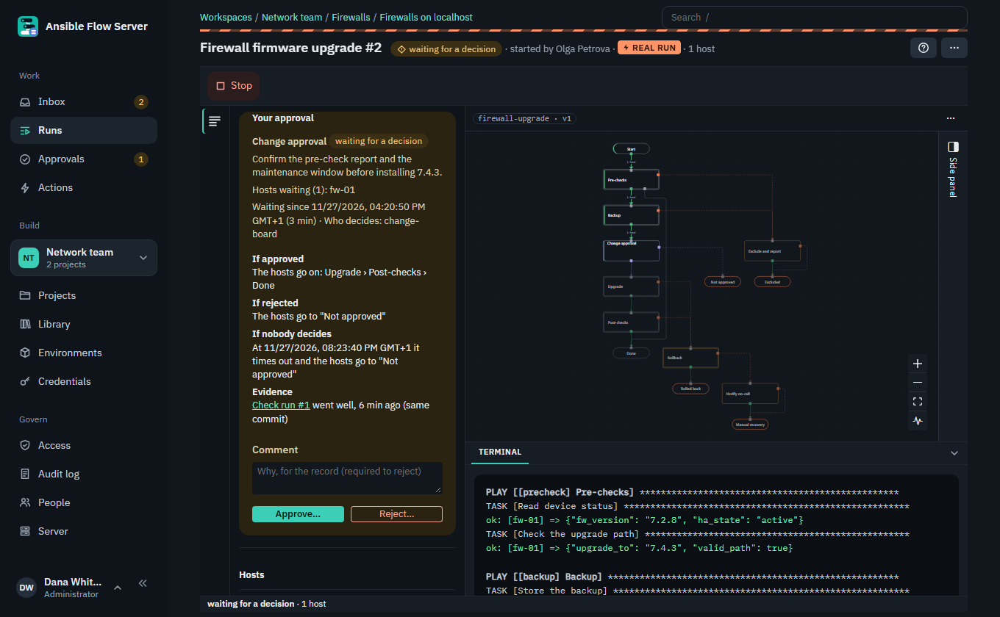
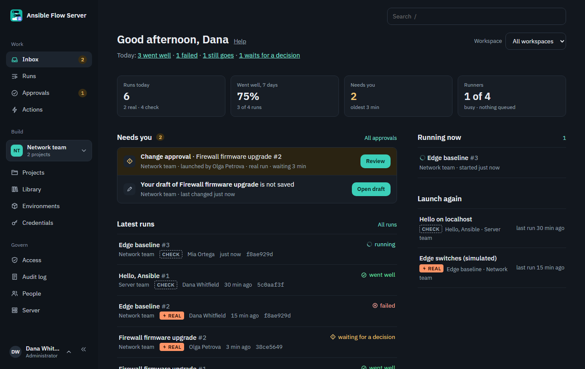
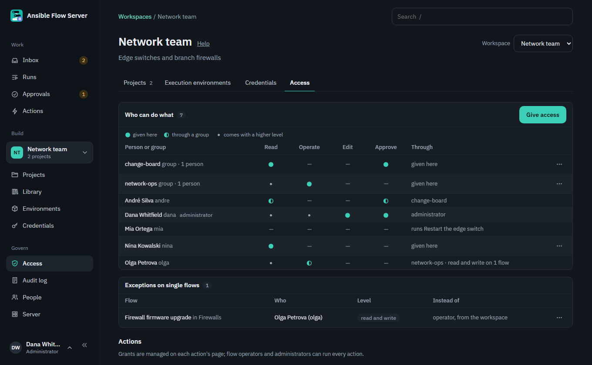
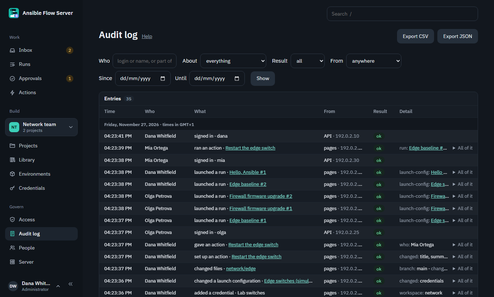

# Ansible Flow Server


Runs the flows you design in [Ansible Flow Designer](https://github.com/ChistokhinSV/ansible-flow-designer)
for a team: shared projects, access levels, approvals, schedules, execution environments, a REST
API and an MCP endpoint.

Ansible Flow Designer is a VS Code extension: you draw an automation as a diagram of steps, say
what happens when a step fails, and it generates plain Ansible playbooks. It runs a flow from your
own machine. This server is where a team runs them: the same flows, read and run by the designer's
own code, with who may run what, who must approve, and a record of every run.



## What it does

- **Projects** from your git repository (HTTPS or SSH), or hosted by the server as a git address
  you clone and push to. Flows are shown on the designer's canvas and can be edited in the pages.
- **Runs** in execution environment containers (docker or podman), live on the canvas: which hosts
  took which wire, each host's output, stop, run again. Launch configurations hold a flow's
  inputs, inventory, credentials and image; schedules launch them at set times.
- **Access levels** per workspace or per flow: read, operate, edit, approve. **Approval steps**
  stop a run until someone allowed decides, by default not the person who launched it.
- **People** sign in with a password, OIDC or LDAP; programs with access tokens and service
  accounts. **Notifications** by email and webhook. Every change is in the **audit log**.
- **Execution environments** built from a list of collections; credentials kept encrypted with a
  master key; HTTPS with a certificate you request and replace in the pages.
- **REST API** (OpenAPI), an **MCP endpoint** for agents, and an **Ansible collection**
  (`chistokhinsv.ansible_flow` on Galaxy) so a flow can launch another and use what it gave back.

## Quick start

The image is `ghcr.io/chistokhinsv/ansible-flow-server`, also on Docker Hub as
`chistokhinsv/ansible-flow-server` (amd64 and arm64):

```sh
mkdir flow-server && cd flow-server
curl -fsSLO https://raw.githubusercontent.com/ChistokhinSV/ansible-flow-server/main/deploy/compose/compose.yaml
curl -fsSL -o .env https://raw.githubusercontent.com/ChistokhinSV/ansible-flow-server/main/deploy/compose/.env.example
# change .env: AFS_PUBLIC_URL at least
docker compose up -d
docker compose logs server | grep -i "setup code"
```

Open the address in that line (the setup page, with the code in it) and make the first
administrator. Then follow
**[First project](docs/guide/install.md#first-project)**: a workspace, a project from a sample, a
launch, and an approval, in about 15 minutes.

To install as a Linux service instead, see [Install and first setup](docs/guide/install.md).

## Documentation

The **[user guide](docs/guide/README.md)**: [editing flows](docs/guide/edit-flows.md),
[importing playbooks](docs/guide/import-playbooks.md), [running playbooks](docs/guide/runs.md),
[debugging](docs/guide/debugging.md), projects and Git, execution environments, credentials,
approvals, actions, schedules, access levels, secret providers, event streaming, the REST API and
MCP, the Ansible collection, certificates, the audit log and operations.

| Inbox across workspaces             | Who can do what                         | The audit log                         |
| ----------------------------------- | --------------------------------------- | ------------------------------------- |
|  |  |  |

## Versions

The server is built on the designer's packages (`@ansible-flow/*`) of one version and serves the
designer's canvas of that version. The major versions go together: server 1.x reads and runs the
flows of designer 1.x. `GET /api/v1/meta` says which designer the server carries (see
[Compatibility with the designer](docs/guide/install.md#compatibility-with-the-designer)).
What changed in each release is in the [changelog](CHANGELOG.md).

## Development

See [docs/development.md](docs/development.md) for building and testing, and
[RELEASING.md](RELEASING.md) for how a release is made and tested. Decisions are in
[docs/adr](docs/adr).

## License

MIT, see [LICENSE](LICENSE).
