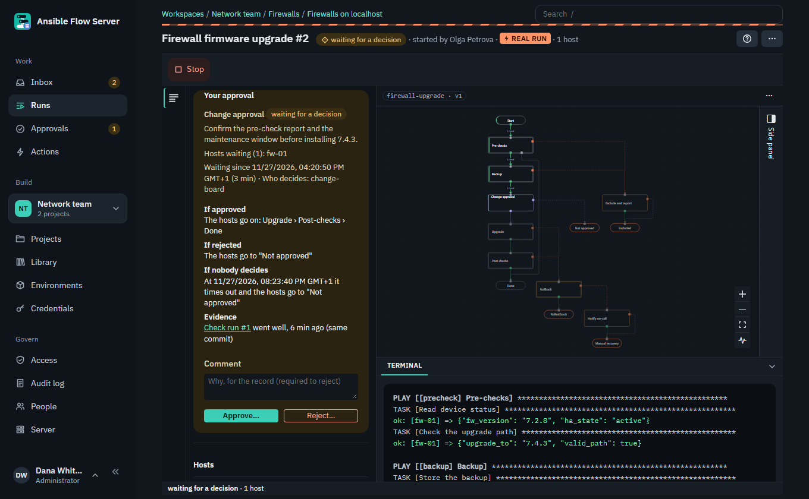

# Ansible Flow Server

Runs the Ansible flows you design in
[Ansible Flow Designer](https://marketplace.visualstudio.com/items?itemName=chistokhinsv.ansible-flow-designer)
(a VS Code extension) for a team: shared projects from git, access levels, approval steps that wait
for a person, schedules, execution environments, notifications, an audit log, a REST API and an MCP
endpoint for agents. Free and MIT licensed.



## Quick start

```sh
mkdir flow-server && cd flow-server
curl -fsSLO https://raw.githubusercontent.com/ChistokhinSV/ansible-flow-server/main/deploy/compose/compose.yaml
curl -fsSL -o .env https://raw.githubusercontent.com/ChistokhinSV/ansible-flow-server/main/deploy/compose/.env.example
# change .env: AFS_PUBLIC_URL at least
docker compose up -d
docker compose logs server | grep -i "setup code"
```

Open the address in that line (the setup page, with the code in it) and make the first
administrator, then follow
[First project](https://github.com/ChistokhinSV/ansible-flow-server/blob/main/docs/guide/install.md#first-project).

The server runs flows in sibling containers through the engine's socket
(`/var/run/docker.sock`), keeps its data in `/var/lib/afs` and listens on 8443 (HTTPS, a
self-signed certificate at first, replaceable in its pages).

## Tags

| Tag            | Is                                               |
| -------------- | ------------------------------------------------ |
| `latest`, `1`  | The newest release                               |
| `1.0`, `1.0.0` | A minor line, an exact release                   |
| `1.0.1-rc.1`   | A release candidate, for testing; never `latest` |

amd64 and arm64. The same image is `ghcr.io/chistokhinsv/ansible-flow-server`.

## More

- [User guide](https://github.com/ChistokhinSV/ansible-flow-server/blob/main/docs/guide/README.md):
  install, configuration, access levels, runs, approvals, the API and MCP, operations
- [Changelog](https://github.com/ChistokhinSV/ansible-flow-server/blob/main/CHANGELOG.md)
- [Source and issues](https://github.com/ChistokhinSV/ansible-flow-server)
