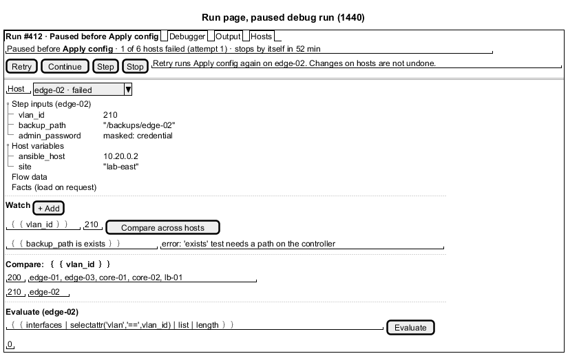
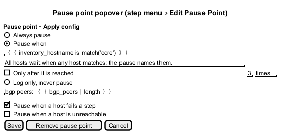
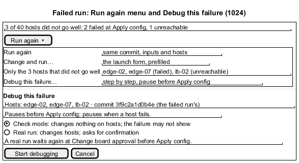
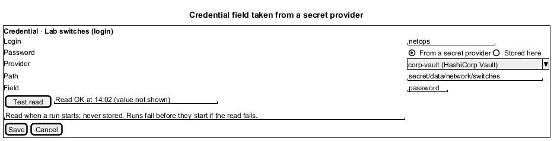

# 1.2 UX spec: debugger, Run again, external secrets

These wireframes are PlantUML salt; render them with `java -jar plantuml.jar -charset UTF-8 -tpng *.puml`. Jinja braces
appear as full-width braces (｛｛ ｝｝) because salt reserves `{` and `|`. The design is in server
ADR-0038 and designer ADR-0040. The acceptance scenarios are in the KB ("1.2 Debugger: user
scenarios").

| Wireframe                                     | What it shows                                                                                                                                                         | Scenarios |
| --------------------------------------------- | --------------------------------------------------------------------------------------------------------------------------------------------------------------------- | --------- |
|  `debugger-panel.puml` | A run page paused on a failure, with: the reason line; Retry, Continue, Step and Stop; the host picker; scopes as a tree; Watch with "compare across hosts"; Evaluate | 1, 2, 3   |
|  `pause-point.puml`       | Pause point settings: always, when a condition holds, after N arrivals, log only; the failure and unreachable filters                                                 | 1, 3, 5   |
|  `run-again.puml`           | A failed run's outcome line; the Run again menu; the Debug this failure dialog (check or real)                                                                        | 2         |
|  `secret-ref.puml`         | A credential field taken from a secret provider, with Test read                                                                                                       | 6         |

## Rules for every screen

- **Width:** 390 px stacks the panel under the canvas: tabs Run · Debugger · Output. At 1024 the
  panel is a drawer beside the canvas, and at 1440 a column.
- **Words:**
  - The reason line always names the step, the count of hosts and why: pause point, step,
    condition, failure or unreachable.
  - Retry always says that the step runs again and that changes on hosts are not undone.
  - A masked value says why it is masked (vault, no_log, credential, external secret, name), never
    its length.
  - A value that was cut says so, with the size it was cut at.
- **Who sees what:**
  - The person driving the run sees buttons, Evaluate and values.
  - Others see the reason line and the canvas, read-only, and "Paused by dana · stops by itself in
    52 min".
- **Keys:**
  - In the pages: F10 Step, F8 Continue or Pause, Ctrl+Enter Evaluate.
  - In VS Code: the keys of VS Code's debugger, with F5, F10 and Shift+F5 as in 1.1.
- **Evaluate:**
  - A refused expression says why: "lookups are not allowed in Evaluate" or "took longer than 2 s".
  - Watches that fail show their error inline and stay in the list.
- **VS Code:** the same pause appears in VS Code's debugger:
  - Call Stack has one thread per host, host name first.
  - Variables shows the same scopes, with Facts marked expensive.
  - The Debug Console runs Evaluate.
  - Breakpoints has the "Host failed" and "Host unreachable" filters.
  - The canvas rings the step as in 1.1.
