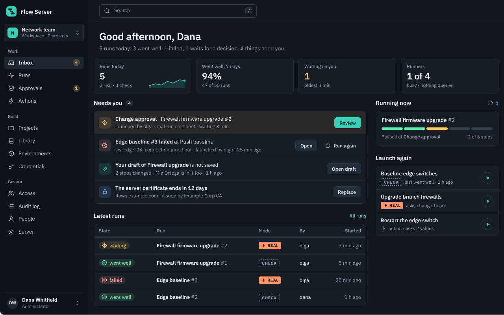
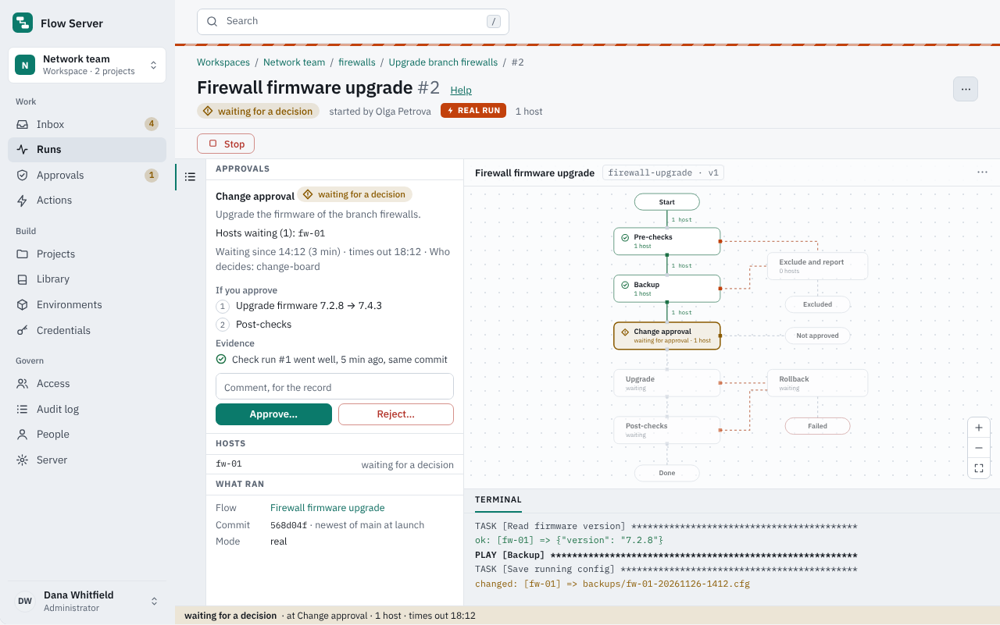
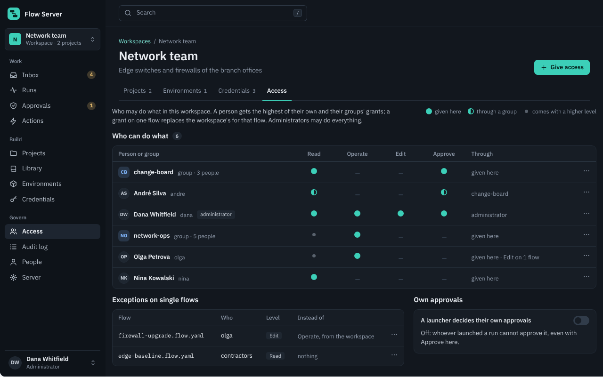
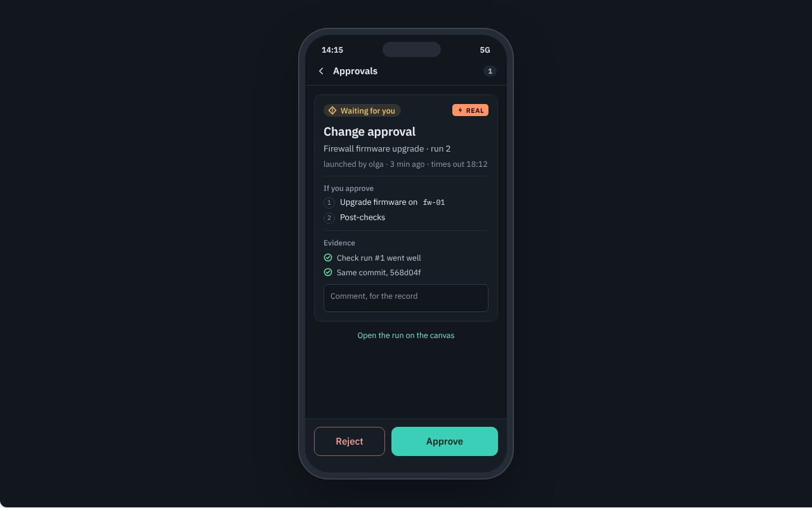

# Control Room 3: mock-ups

The pages' structure and look for 1.2, as decided in server ADR-0039 (epic AFS-267). These are
static mock-ups at 1280 × 800, drawn before the pages were built: where a page and its mock-up
differ, the page and the guide are right. Names, hosts and numbers are the guide's fictional sample
workspace.

| Mock-up                                  | What it shows                                                                                                                                                                           |
| ---------------------------------------- | --------------------------------------------------------------------------------------------------------------------------------------------------------------------------------------- |
|   | Home as an inbox: the day in one sentence, four numbers, what needs you (each with its verb), running now, launch again, the latest runs with a state's shape and a Real or Check badge |
|       | A real run waiting for a decision, on the debug workbench as built: the side bar on the left (Details, with the approval first), the canvas, the Terminal panel and the status line     |
|                      | A launch configuration: the form, What will run kept current beside it, Check or Real as a choice, the button that names the run                                                        |
|                      | A workspace's access as a matrix (given here, through a group, comes with a higher level), grants on single flows, row menus                                                            |
|                       | An approval at phone width, with Reject and Approve at the bottom of the screen                                                                                                         |

What to build from each picture is what ADR-0039 decides, and nothing more:

- **The run page** keeps the debug workbench's layout (AFS-265, AFS-266). From the run mock-up,
  build only the head's state shape, the Real badge and the real run's stripe (AFS-269), the
  canvas in the page's colours (AFS-270), and the approval card's next steps and evidence
  (AFS-271).
- **The side menu** (workspace switcher, Work / Build / Govern, the account at its end) is AFS-274.
  Whether Work follows the switcher is the record's open question 1; it is not built until
  answered.
- **The top bar** is today's: the search box only.
