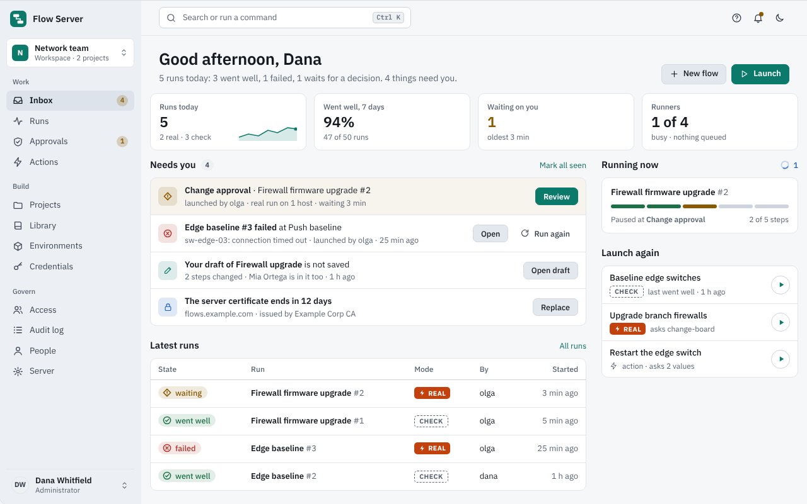
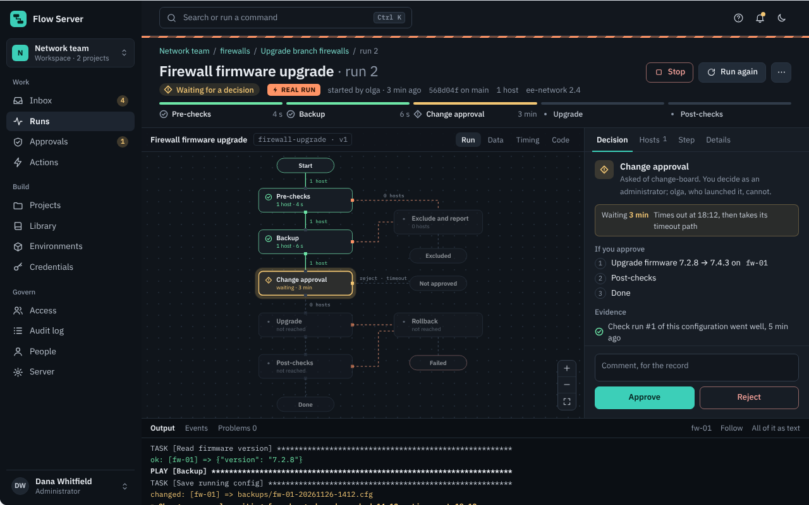
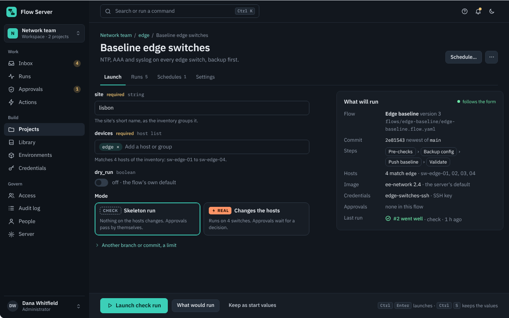

# Control Room 3: mock-ups

The pages' structure and look for 1.2, as decided in server ADR-0039 (epic AFS-267). These are
static mock-ups at 1280 × 800, drawn before the pages were built: where a page and its mock-up
differ, the page and the guide are right. Names, hosts and numbers are the guide's fictional sample
workspace.

| Mock-up                                  | What it shows                                                                                                                                                                                       |
| ---------------------------------------- | --------------------------------------------------------------------------------------------------------------------------------------------------------------------------------------------------- |
|   | Home as an inbox: the day in one sentence, four numbers, what needs you (each with its verb), running now, launch again, the latest runs with a state glyph and a Real or Check badge. The new menu |
|       | A real run waiting for a decision: the hatched stripe of a real run, the step strip, the canvas in the page's colours, the decision with what it lets happen and the evidence, the docked output    |
|                      | A launch configuration: the form, What will run kept current beside it, Check or Real as a choice, the button that names the run                                                                    |
|                      | A workspace's access as a matrix (given here, through a group, comes with a higher level), grants on single flows, row menus                                                                        |
|                       | At phone width: an approval with Reject and Approve at the bottom, and an action's progress                                                                                                         |

The run page's side bar, toolbar and panel are the debug workbench's (ADR-0038, AFS-265, AFS-266);
the mock-up shows only what Control Room 3 adds to it (the header, the state glyphs, the colours).
