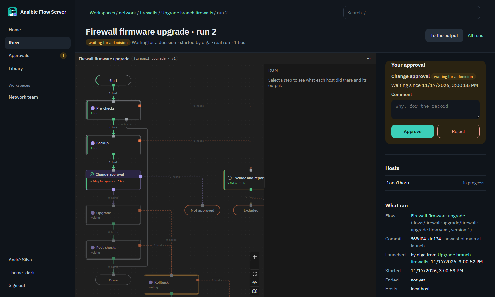

# Ansible Flow Server: user guide

Ansible Flow Server runs the flows you design in
[Ansible Flow Designer](https://github.com/ChistokhinSV/ansible-flow-designer) for a team: shared
projects, access levels, approvals, schedules, execution environments, a REST API and an MCP
endpoint for agents.

## Start here

1. **[Install](install.md)** with docker compose (the image is on GitHub's registry and Docker
   Hub) or as a Linux service.
2. **[Your first project](first-project.md)**: make the first administrator, a workspace and a
   project from a sample, launch a flow, and decide its approval. 15 minutes.
3. **[Your first flow](first-flow.md)**: a flow made in the web pages, saved and launched. 10
   minutes.
4. Give people access: **[People, groups and sign-in](people-and-sign-in.md)**.

## Running flows

| Page                                                  | About                                                                                           |
| ----------------------------------------------------- | ----------------------------------------------------------------------------------------------- |
| [Workspaces and projects](workspaces-and-projects.md) | Where flows live: a git repository of yours, or one the server hosts                            |
| [Launch configurations](launch-configurations.md)     | A flow with its inputs, inventory, credentials and image: what Launch runs                      |
| [Runs](runs.md)                                       | The queue, a run on the canvas, its hosts and output, stop and run again; dev runs from VS Code |
| [Debug a run](debugging.md)                           | Pause where a host fails, read each host's variables, watch, evaluate, retry a step             |
| [Actions](actions.md)                                 | A short form to run an approved thing, for people who do not read flows                         |
| [Approvals](approvals.md)                             | A run waits at an approval step until someone allowed decides                                   |
| [Schedules](schedules.md)                             | Launch a configuration at set times                                                             |
| [Execution environments](environments.md)             | The images runs use, built from a list of collections                                           |
| [Credentials and the master key](credentials.md)      | SSH keys, passwords, vault passwords and tokens, kept encrypted                                 |
| [Notifications](notifications.md)                     | Email and webhooks: who is told of what                                                         |
| [The web pages](web-pages.md)                         | Home, the canvas, editing flows and files in the pages, the flow library                        |

## For administrators

| Page                                                | About                                                                    |
| --------------------------------------------------- | ------------------------------------------------------------------------ |
| [Configuration](configuration.md)                   | Every setting, from the environment or a `.env` file                     |
| [Secret providers](secret-providers.md)             | Credentials that read their secrets from Vault, CyberArk or AWS          |
| [HTTPS and the certificate](certificates.md)        | The server's certificate: request, install, replace, roll back           |
| [People, groups and sign-in](people-and-sign-in.md) | Users, groups, access levels, tokens, OIDC and LDAP                      |
| [The audit log](audit.md)                           | Who did what and when, filtered and exported                             |
| [Event streaming](event-streaming.md)               | Audit entries and runs to syslog (a SIEM) and OpenTelemetry              |
| [Operations](operations.md)                         | Metrics, health checks, backup and restore, upgrades                     |
| [Start the server](getting-started.md)              | Starting it by hand, what it answers at, compatibility with the designer |

## Programs and agents

| Page                                       | About                                                                                  |
| ------------------------------------------ | -------------------------------------------------------------------------------------- |
| [The API and agents (MCP)](api-and-mcp.md) | The REST API (OpenAPI), access tokens, and the MCP endpoint for agents                 |
| [Ansible collection](collection.md)        | `chistokhinsv.ansible_flow`: launch and follow runs, keep the server's objects as code |

The examples in this guide use fictional names: the `network` workspace of the Network team, the
people Dana (administrator), Olga (operator), André (approves for the change board) and Nina
(reads), and hosts under `example.net`.
