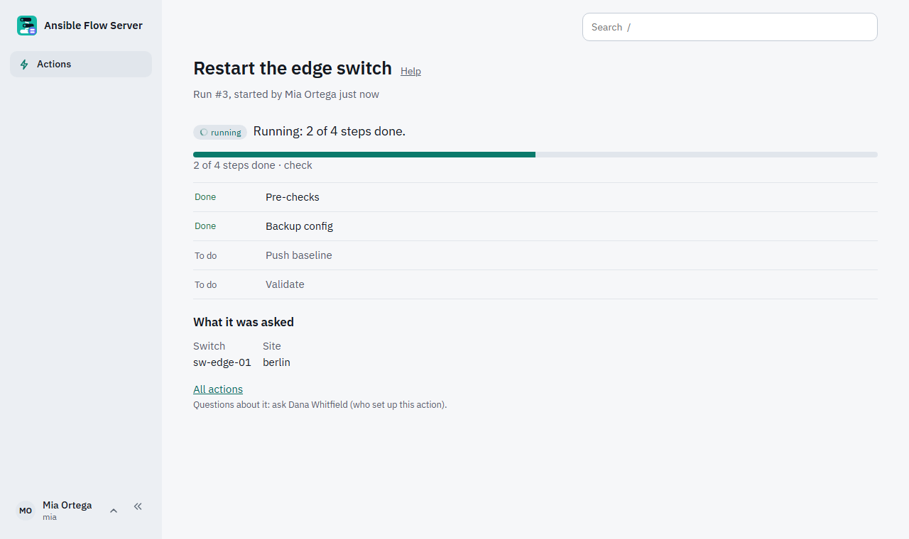

# Actions

[The guide](README.md)

An **action** wraps a launch configuration in a simple self-service form for people who need to run
an approved task without reading flows, Git commits or inventories — such as a service desk
resetting a port or an on-call manager restarting an edge switch.

## Turn a launch configuration into an action

With `rw` on the workspace (or as an administrator), open a launch configuration's **Settings** and
click **Make it an action** (managed at `/actions/<id>/edit`):

- **Title** and **What it does**: plain words shown to runners (_Restart the edge switch_).
- **What it asks**: tick only the inputs the runner should choose, giving each a friendly label and
  help text. Unticked inputs stay locked to the configuration's values (secrets are never asked —
  supply them via [credentials](credentials.md)).
  - Constrain inputs with comma-separated **Choices**, or restrict a host list to **Only hosts of
    group** and cap **How many hosts** (_one host_, _up to N_, or _any number_). Asked host lists
    start empty unless you set **Starts with**.
- **Mode and confirmation**: fix whether the action runs as **Check** or **Real**, and whether
  **Run** asks to confirm first.
- **Who may run it**: grant the action to specific users or groups. An action grant exposes _only_
  that action and the runner's own runs of it — nothing else in the workspace. Operators, editors
  (`rw`) of the flow and administrators can already run it.

## Running an action and watching progress

Runners open **Work › Actions**, fill the short form, review **What will happen** (mode, step titles
and any [approvals](approvals.md) it will wait for), and press **Run** (duplicate submissions within
30 seconds prompt before running twice).

Progress updates live in plain words (`/actions/runs/<run>`): current step count, approval status,
and clear error guidance naming the action's owner if a step fails. Users with `ro` on the flow also
get a link to **The full run page**.

## Links from NetBox and Zabbix

Under **Links** on the action's edit page (`/actions/<id>/edit`), you can generate pre-filled URLs
(`https://flows.example.com/a/<action id>?<input>=<value>&…`):

- **A link with values**: pre-fill some or all inputs to paste into tickets, chat or runbooks.
  Opening a link never starts a run by itself unless you explicitly enable **Run as soon as a
  complete link opens**; otherwise a complete link opens a confirmation screen and an incomplete one
  opens the form for the remaining fields.
- **Copy link for NetBox / Zabbix**: generates ready-to-paste templates mapping device/host fields:
  - **NetBox**: add under **Customization › Custom Links** on _DCIM › Device_ using Jinja macros
    like `{{ object.name|string|urlencode }}` (or `POST /api/extras/custom-links/`).
  - **Zabbix**: add under **Alerts › Scripts** (_Manual host action_ or _Manual event action_, type
    _URL_) using `{HOST.HOST}`, `{HOST.IP}`, `{EVENT.ID}` or `{MANUALINPUT}`.
- **Result back**: choose a workspace **NetBox token** or **Zabbix token** credential to post run
  outcomes and progress links back as a NetBox device journal entry or Zabbix problem message
  (requires `AFS_PUBLIC_URL`).
- **Signed links (automated triggers)**: for webhooks or Zabbix trigger actions with no signed-in
  person, click **Make a signed link** to mint a scoped `afsl_…` bearer token accepted only on
  `POST /api/v1/actions/<id>/run` and revocable at any time.
