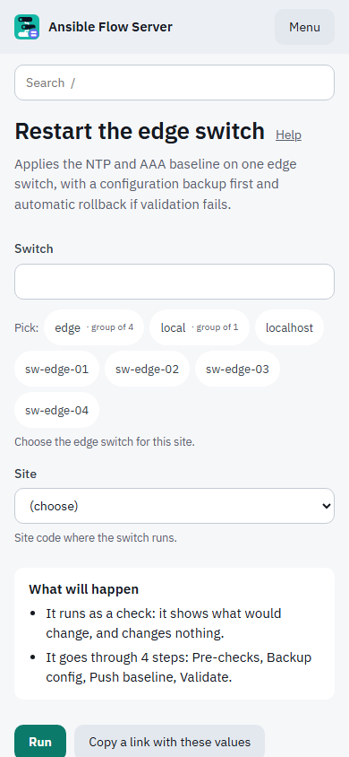

# Actions

[The guide](README.md)

An **action** wraps a launch configuration in a simple self-service form for people who need to run
an approved task without reading flows, Git commits or inventories — such as a service desk
resetting a port or an on-call manager restarting an edge switch.



## Turn a launch configuration into an action

With `rw` on the workspace (or as an administrator), open a launch configuration's **Settings** and
click **Make it an action** (managed at `/actions/<id>/edit`; the action's ID is its launch
configuration's ID):

- **Title** and **What it does**: plain words shown to runners (_Restart the edge switch_). Whoever
  saves the action last becomes its **owner**, named to runners when something goes wrong.
- **What it asks**: tick only the inputs the runner should choose, giving each a friendly label and
  help text. Unticked inputs stay locked to the configuration's values (secrets are never asked —
  supply them via [credentials](credentials.md)).
  - Constrain inputs with comma-separated **Choices**, or restrict a host list to **Only hosts of
    group** (choices and a group cannot be combined) and cap **How many hosts** (_one host_, _up to
    N_, or _any number_). Asked host lists start empty unless you set **Starts with**.
- **Mode and confirmation**: fix whether the action runs as **Check** or **Real**, and whether
  **Run** asks to confirm first. Actions never run step by step, while [approvals](approvals.md) in
  the flow still wait for authorized approvers as usual.
- **Who may run it**: grant the action to specific users or groups (workspace `rw` editors can grant
  to users/groups who already have access in the workspace; administrators can grant to anyone). An
  action grant exposes _only_ that action and the runner's own runs of it — nothing else in the
  workspace. Operators, `rw` editors of the flow and administrators can already run it.

## Running an action and watching progress

Runners open **Work › Actions**, fill the short form, review **What will happen** (mode, step titles
and any approvals ahead), and press **Run** (identical submissions within 30 seconds ask before
running twice).


Progress updates live in plain words (`/actions/runs/<run>`): current step count, approval status,
and clear error guidance naming the action's owner if a step fails. Users with `ro` on the flow also
get **The full run page**.

## Links from NetBox and Zabbix

Under **Links** on `/actions/<id>/edit`, you can generate pre-filled URLs
(`https://flows.example.com/a/<action id>?<input>=<value>&…`):

- **A link with values**: pre-fill some or all asked inputs to share in tickets, chat or runbooks
  (runners also have **Copy a link with these values** on the form). Opening a `GET` link never
  starts a run by itself unless **Run as soon as a complete link opens** is enabled; otherwise a
  complete link opens a confirmation page and an incomplete one asks only for the missing fields.
- **Copy link for NetBox / Zabbix**: generates ready-to-paste templates:
  - **NetBox**: add under **Customization › Custom Links** on _DCIM › Device_ using Jinja macros
    such as `{{ object.name|string|urlencode }}` (or `POST /api/extras/custom-links/`).
  - **Zabbix**: add under **Alerts › Scripts** (_Manual host action_ or _Manual event action_, type
    _URL_) using `{HOST.HOST}`, `{HOST.IP}`, `{EVENT.ID}` or `{MANUALINPUT}`.

### Result back

Configure **Result back** on the action's settings with a workspace **NetBox token** or **Zabbix
token** [credential](credentials.md) (and set `AFS_PUBLIC_URL`) to post plain-language outcomes and
progress links back when runs started from a link finish:

- **NetBox**: writes a **journal entry** on the object. The link carries
  `_reply=dcim.device:{{ object.id }}` (added automatically by **Copy link**), and the NetBox API
  token needs permission to **add journal entries**.
- **Zabbix**: posts a **message on the problem** (acknowledgement message without closing it). The
  link carries `_reply=event:{EVENT.ID}` (added automatically for problem-menu links), and the
  Zabbix token's user needs permission to **acknowledge problems** on the host.

### Signed links (automated triggers)

For Zabbix trigger actions or NetBox webhooks with no person to sign in, open **Links › Signed
links**, enter a name and click **Make a signed link**:

- The `afsl_…` token is **shown once** — store it in the calling system.
- It is accepted **only in the `Authorization: Bearer` header** of `POST /api/v1/actions/<action
  id>/run` — **never in a URL**, and no other endpoint accepts it:

```sh
curl -X POST https://flows.example.com:8443/api/v1/actions/<action id>/run \
  -H 'Authorization: Bearer afsl_…' -H 'Content-Type: application/json' \
  -d '{"inputs": {"devices": "{HOST.HOST}"}, "reply": "event:{EVENT.ID}"}'
```

- Every run started with the signed link **runs as you** (recorded in the [audit log](audit.md) with
  your account and the token's name).
- **Revoke** stops the signed link immediately; disabling/removing the action or disabling/deleting
  your account stops it too.

The [API reference](/docs/api) lists every `/api/v1/actions` and `/launch-configs/:id/action` call
and who may make it.
