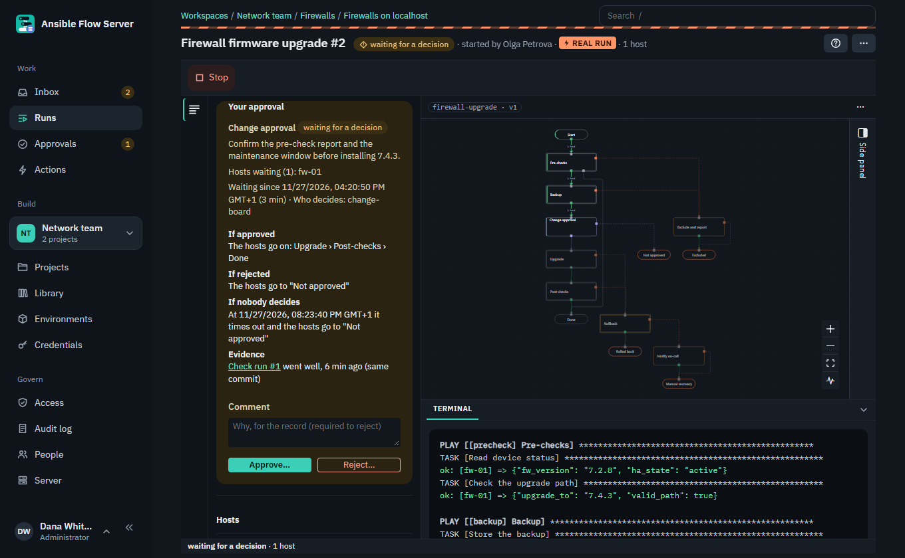
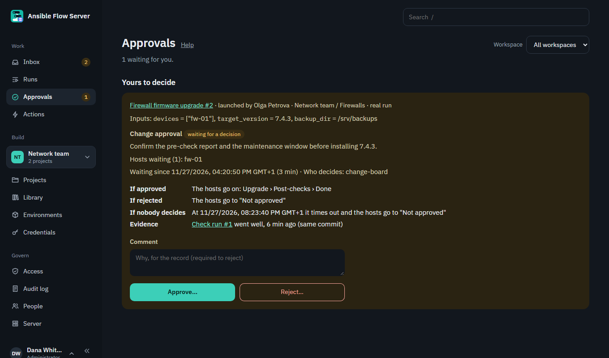

# Approvals

[The guide](README.md)

Top-level **approval** steps pause a **Real** run in segments: once hosts reach the gate, the server
records the waiting state and releases the worker container, so waiting runs consume zero runner
slots and survive server restarts. **Check** runs pass approval gates automatically without asking
or notifying anyone.

## Who may decide

- Users or groups with the `approve` grant on the flow or workspace (see
  [Access levels](people-and-sign-in.md#access-levels)) — narrowed to the step's named `approvers`
  when set in the flow. Administrators can always decide.
- **No self-approval by default**: whoever launched the run cannot approve it unless an
  administrator enables **A launcher decides their own approvals** under **Govern › Access**
  (`selfApprove`).

## Reviewing, deciding and timeouts

Open **Work › Approvals** (`/approvals`), the run's **Details** side bar, or the step on the canvas.
Before you decide, each gate shows what happens next:

- **If approved**: the step sequence hosts will run next (`Upgrade › Post-checks › Done`).
- **If rejected**: where hosts route instead (`Not approved`).
- **If nobody decides (`settings.timeout`)**: when an approval step configures `settings.timeout`
  and nobody decides in time, the gate times out and sends waiting hosts through its **`timeout`
  port, or through `rejected` when `timeout` is not wired**.
- **Evidence**: the latest completed **Check** run of the same launch configuration that had ended
  before this run was launched (how it went, when, and whether at the same commit).

Enter a **Comment** (optional when approving, **required** when rejecting) and confirm **Approve…**
or **Reject…**. Every decision is recorded on the run, in [notifications](notifications.md) and in
the [audit log](audit.md). Runs that fail because an approval was rejected or timed out read and
filter as **rejected** (or **not decided in time**) rather than failed.

## Limits

- Approval steps must sit at the top level of a flow and two gates cannot wait simultaneously
  (`awx-segments`).
- Stopping a waiting run closes its gate and notifies the asked approvers that no decision is needed.

The [API reference](/docs/api) lists `/api/v1/approvals`, `/api/v1/runs/:id/approvals` and who may
call each.
