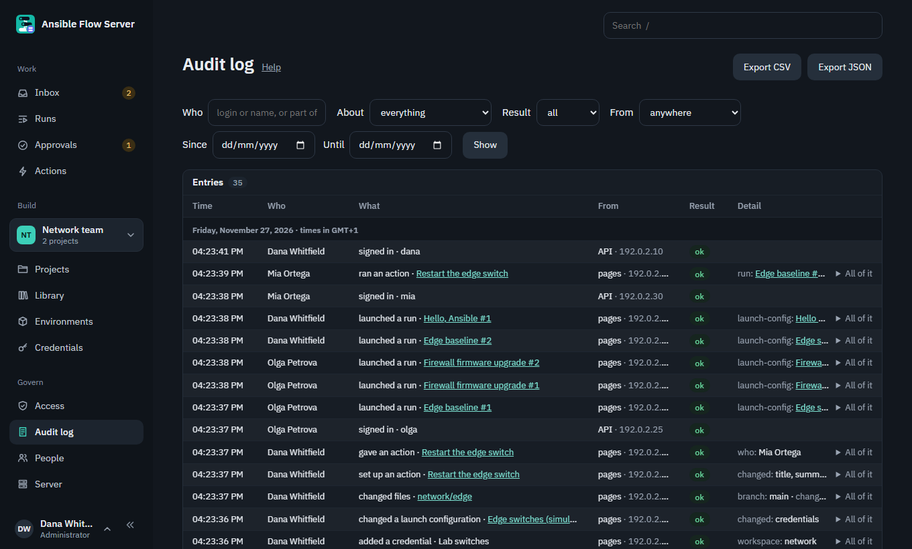

# The audit log

[The guide](README.md)



Everything that changes something, or tries to, leaves an entry: who (the user, and the token
when one was used), from where (`ui`: the pages, `api`: a token, `git`, `cli`: the server's
commands), what (`run.launch`, `user.change`, `session.sign-in`, ...), to what (by id and by
name, so a deleted thing is still named), how it ended (`ok`; `refused`: the server said no,
such as no access, a field that is not right or a login already taken; `failed`: it could not do
it; with the HTTP status), the client's address and the request id of the server's log.

- Sign-ins, refused ones too (by the login tried); sign-outs; passwords set or changed.
- Tokens made (with what they reach: one workspace, or every workspace) and revoked. An entry
  made with a token names it, beside where it came from; the name stays after the token is
  revoked. People and groups made, changed, deleted; who was added to a group
  and who left it, by login. A person not made is named by the login tried, with the reason.
- Access grants given and taken back, named with the workspace (or flow) they are on.
- Workspaces, projects, credentials, launch configurations, schedules and environments made,
  changed, deleted; syncs and push hooks. A change names only the fields whose values changed.
- Runs launched, stopped, run again, named by their flow and number (`Firewall firmware upgrade
  #5`). Approvals decided: the decision, the approval by its title, and the comment it was given
  with. Pushes through the server with the branches they moved;
  refused pushes.
- The `user`, `cert` and `secrets` commands that change something, with the machine's user.
- Exports of the log itself.

An entry never holds a secret: of what a request sent it keeps the names of the changed fields
and the yes/no and number values, never text (the one exception is an approval's comment, which
is kept as the record of why it was decided). A refusal of a change to people, groups, workspaces,
projects, grants, launch configurations, schedules, environments, runs or approvals keeps the
server's reason. On the page, **About** filters by kind (access grants, schedules, approvals and
the rest). Entries are only added; those older than
`AFS_AUDIT_KEEP_DAYS` (365, `0` keeps all) are removed every hour. Administrators read it on the
page `/admin/audit`, or:

| Address (under `/api/v1`) | Answers                                                                                                                                                                                               | Who            |
| ------------------------- | ----------------------------------------------------------------------------------------------------------------------------------------------------------------------------------------------------- | -------------- |
| `GET /audit`              | `{entries, next}`, newest first. Filters: `actor`, `action` (`run` or `run.launch`), `objectType`, `objectId`, `result`, `source`, `from`, `to`. Paging: `before=<next>`, `limit` (100, at most 1000) | administrators |
| `GET /audit/export`       | The same filters, as a file: `format=csv` (default) or `json`; at most 50000 entries                                                                                                                  | administrators |

```sh
curl -H "Authorization: Bearer $AFS_TOKEN" -o audit.csv \
  "https://flows.example.net:8443/api/v1/audit/export?format=csv&action=run&from=2026-11-01"
```

```text
at,actor,token,source,action,object_type,object_id,object_name,result,status,ip,request,detail
2026-11-13T09:12:04.118Z,dana,,ui,run.stop,run,6f1c…,#12,ok,202,192.0.2.10,req-2k,
2026-11-13T09:11:40.502Z,dana,8a0e…,api,run.launch,run,6f1c…,#12,ok,201,192.0.2.10,req-2h,"{""launch-config"":""c41d…""}"
2026-11-13T08:59:13.077Z,omar,,git,git.push,project,,net/firewalls,refused,403,192.0.2.25,req-1x,
```
