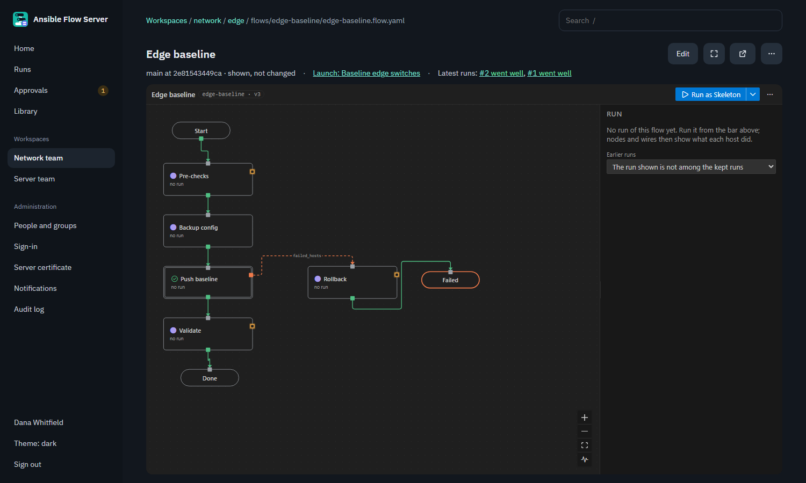

# Edit flows

[The guide](README.md)

A flow (`*.flow.yaml`) is a diagram of steps, host ports and failure paths that compiles into plain
Ansible playbooks. This server embeds the canvas of
[Ansible Flow Designer](https://github.com/ChistokhinSV/ansible-flow-designer), so you can build and
edit flows either **in the browser** or **in VS Code** with the Ansible Flow Designer extension.

You need **Edit** (`rw`) access on the workspace or on the flow (administrators always have it; see
[Access levels](people-and-sign-in.md#access-levels)).

## The flow's page

- **Header**: the flow's name, then **Edit** (or **Open the draft** while a draft is open), **Full
  screen** (`Esc` returns), **Open on its own page**, **?** (this page) and **⋯**: **History**, and
  with Edit access **Copy the flow…** and **Delete the flow…**.
- **The line under the name**: the branch and commit shown (read only), a **Launch: …** link for each
  of the flow's launch configurations, and the flow's latest runs with how each went.
- **The canvas** is the designer's: the palette on the left, **Details** on the right, and on its top
  bar the flow's key and version. While you edit, the top bar also has **Design**, **Code** and
  **Run**, **Lens**, **Generate Code** and **⋯**. The designer's
  [Canvas basics](https://github.com/ChistokhinSV/ansible-flow-designer/blob/main/docs/guide/how-to/canvas-basics.md)
  explains each part.

## Create a flow in 5 steps

1. **New flow**: open a project's **Overview** and click **New flow** (also available in an empty
   hosted project). Name it — for example `NTP baseline`, stored at
   `flows/ntp-baseline/ntp-baseline.flow.yaml` — and click **Make the flow**. It opens in the
   editor with **Start** wired to **Done** and a `devices` host input.
2. **Add steps**: click **Add a Step** on the start card (or drag from the left palette), name the
   step, and press `Enter`. With a step selected, press `N` to add the next step after it. To import
   existing work instead, see [Import playbooks](import-playbooks.md).
3. **Bind Ansible modules**: select a step and open **Details** on the right to bind a module from
   the flow's execution environment catalog and fill its parameters. The server indexes the image's
   plugin docs on first use.
4. **Handle failures**: each step has `ok_hosts` and `failed_hosts` ports. An unwired `failed_hosts`
   port highlights in amber and offers one-click failure patterns above the canvas (**Exclude and
   Report**, **Rollback**, **Notify On-Call and Stop**, or **Accept with Reason…**).
5. **Save**: press **Save** (`Ctrl+S` / `Cmd+S`), review the generated commit message, and confirm.
   To run the flow, see [Run playbooks](runs.md).

## Shared drafts

Pressing **Edit** on a flow's page opens a live draft shared by everyone editing that flow:

- **Real-time collaboration**: every edit applies immediately on everyone's canvas. Initials in the
  header show who is present and what changed last; **N earlier** lists prior edits.
- **Personal undo**: `Ctrl+Z` undoes only _your_ last edit without reverting teammates' work (if
  someone edited the same field after you, undo tells you why it kept theirs). `Ctrl+Y` or
  `Ctrl+Shift+Z` redoes it.
- **Saving**: **Save** (`Ctrl+S`) commits the draft to the project's branch with you as author and
  every other contributor as `Co-authored-by`, bumping `flow.version` when logic changed. If the
  branch moved while the draft was open, the server merges non-overlapping changes automatically and
  lets you choose between draft and branch values for any conflict.
- **Leaving or discarding**: **Stop editing** leaves the draft saved on the server so you or a
  teammate can resume with **Open the draft**. While a draft waits, the flow's page says whose
  unsaved edits it holds, and anyone with Edit access can **Discard the draft** there without
  opening it. **Discard** drops unsaved edits, with **Bring back** available for 15 minutes.
- **Runs use the branch, not the draft**: save your draft before launching a run.

## Inspect variables and changes

- **Where values come from**: hover a variable or open **Details › Data** (and pick a host in **For
  host**) to see every definition across the flow, inventory, `group_vars/` and `host_vars/`, ordered
  by Ansible precedence, with links straight to the file and line on **Files**.
- **Branch updates and history**: if someone pushes to the branch while you view a flow, a banner
  offers **Show changes** (opening the **Changes** lens against your previous commit) or **Update**.
  Open **⋯ › History** on the flow page to compare any earlier commit.
- **Edit in VS Code**: install
  [Ansible Flow Designer](https://github.com/ChistokhinSV/ansible-flow-designer), clone the project
  from **Settings** (see
  [Git: clone, fetch and push](workspaces-and-projects.md#git-clone-fetch-and-push-through-the-server)),
  and connect the extension to this server to edit locally, share the subflow library, or test
  unpushed changes with [Dev runs](runs.md#dev-runs).

## Flow library

Administrators can mark a project as a **library** on its **Settings** tab (**Make it a library**).
All subflows in that project then appear under **Build › Library** for anyone with at least Read
(`ro`) access to the library's workspace.

- While editing a flow (in the browser or in VS Code connected to this server), click **Insert
  Shared Subflow…** to copy a library subflow into your flow, pinned to its version and commit.
- Runs execute the embedded copy directly. When the library flow's `flow.version` increases,
  flows using an older copy show **From the library** with an **Update** button in edit mode.

## Shortcuts

| Keys                     | Action                                           |
| ------------------------ | ------------------------------------------------ |
| `N`                      | Add a connected step after the selected step     |
| `Ctrl+S` (`Cmd+S`)       | Save the draft (or submit the active form)       |
| `Ctrl+Z`                 | Undo your own last edit in the draft             |
| `Ctrl+Y`, `Ctrl+Shift+Z` | Redo what `Ctrl+Z` undid                         |
| `/` or `Ctrl+K`          | Search flows, projects, runs and pages           |
| `Esc`                    | Exit full screen or close the open dialog / menu |

The [API reference](/docs/api) lists every flow, draft, variable-index and library call and who may
make it.
