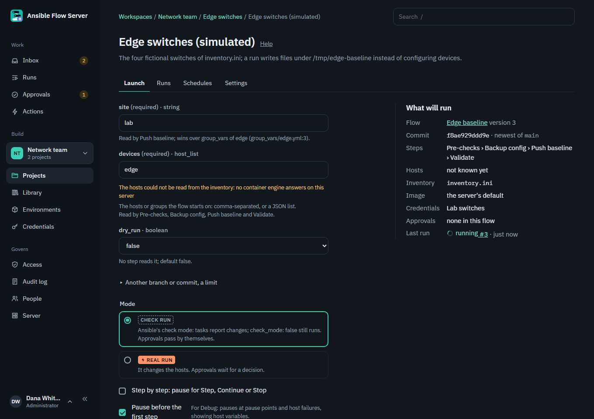
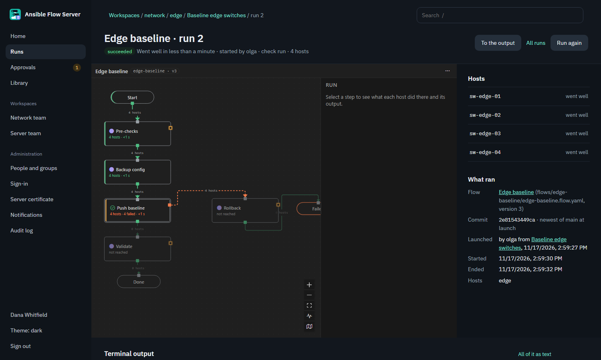
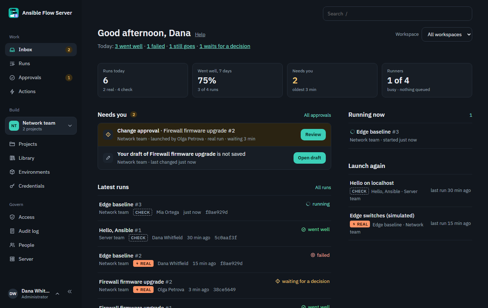

# Your first project

[The guide](README.md)

From an installed server to a flow that waited for an approval and ran, in about 15 minutes. The
flow is the designer's **Firewall firmware upgrade** sample: its steps are drafts that run on
`localhost`, so nothing outside the server is touched.

You need a server [installed with docker compose](install.md#run-with-docker-compose) and its
address, here `https://flows.example.net:8443`.

## 1. Make the first administrator

The server prints a one-time **setup code** in its log at the first start:

```sh
docker compose logs server | grep -i "setup code"
```

The line names the address to open, such as
`https://flows.example.net:8443/setup?code=Jq3vN0c4TzWk`. It shows **Set up Ansible Flow
Server** with the setup code filled in: enter your login, name and a password, then **Make the
administrator**. You are signed in.

The server's certificate is self-signed at first; the browser warns once. To give it a real one,
see [HTTPS and the certificate](certificates.md).

## 2. A workspace and a project

1. **Workspaces** → **Add workspace**: key `network`, name `Network team`.
2. In the workspace, **Add project**: key `firewalls`, name `Firewalls`, **Start with** a sample,
   **Firewall firmware upgrade**, then **Start**.

The server hosts the project's git repository: the sample's flow is its first commit. To work on
it in VS Code, the project's **Work on it with git** shows the address to clone (see
[Workspaces and projects](workspaces-and-projects.md)).

## 3. A launch configuration

Open the flow `flows/firewall-upgrade/firewall-upgrade.flow.yaml` from the project's Overview: its
page shows the flow on the designer's canvas.

The sample came with one: **Skeleton on localhost**, with the flow's inputs filled in (`devices`
`localhost`, `target_version` `7.4.3`). A launch configuration is what **Launch** runs: the flow
with its inputs, inventory, credentials and image (see
[Launch configurations](launch-configurations.md)).

To make your own, **Add a launch configuration** in the project: name `Upgrade branch firewalls`
and the flow above. On its **Launch** tab fill the flow's inputs, `devices` `localhost` and
`target_version` `7.4.1`, and **Keep as start values**.



## 4. A skeleton run

On the configuration's **Launch** tab, keep the mode **Check** and press **Launch**. A check run
is a skeleton: nothing is changed and approvals pass by themselves. The run's page shows it on
the canvas as it goes: how many hosts took each wire, and each host's output.



## 5. A real run with an approval

Give someone the right to decide: **Access** in the workspace → **Give access**, a person or a
group with the level `approve` (see [Access levels](people-and-sign-in.md#access-levels)). Only
they may decide; by default not the person who launched the run.

Launch again with the mode **Real**. The run stops at **Change approval** and waits, holding no
worker. The approver sees it on **Home** and on **Approvals**, and is told by email or webhook
when [notifications](notifications.md) are set up.



The approver opens the run, writes why in **Comment** and presses **Approve**: the hosts go on to
the upgrade. **Reject** sends them to **Not approved**. Both are in the [audit log](audit.md).

## Next

- Your own repository as a project, and SSH keys or passwords for real hosts:
  [Workspaces and projects](workspaces-and-projects.md), [Credentials](credentials.md).
- Runs at set times: [Schedules](schedules.md).
- An image with the collections your flows use: [Execution environments](environments.md).
- Launch from a script, CI or an agent: [The API and agents](api-and-mcp.md), or from another
  flow with the [Ansible collection](collection.md).
