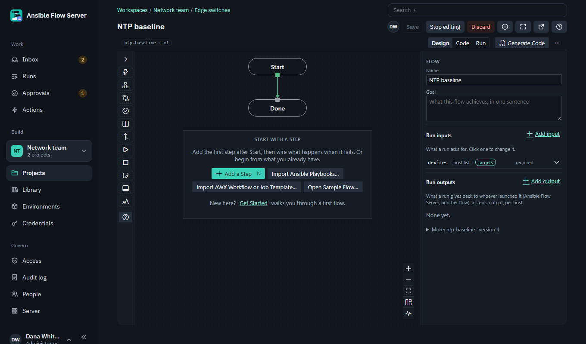

# Import playbooks

[The guide](README.md)

You do not need to redraw existing automation from scratch. Bring your Ansible repository into a
project, then turn existing playbooks or AWX templates into flows in one step — either in the web
editor or in VS Code with
[Ansible Flow Designer](https://github.com/ChistokhinSV/ansible-flow-designer).

## 1. Put your playbooks and roles in a project

Choose the setup that matches where your files live today (see
[Workspaces, projects and Git](workspaces-and-projects.md)):

- **Connect an existing Git repository**: in a workspace, click **Add project** and enter its
  `https://` or `ssh://` URL (plus a Git token or SSH key credential if private). The server mirrors
  the repository and stays in sync by webhook or polling.
- **Upload to a server-hosted project**: click **Add project** with no external URL. You can unpack
  a `.zip` or `.tar.gz` archive right at creation (**Start with › An archive of files**), upload
  files and folders on the project's **Files** tab (**Upload files**, **Upload a folder (zip)**) and
  press **Save**, or `git push` to the project's `/git/<workspace>/<project>.git` address.

Your existing repository layout works as-is: runs automatically load the project's `ansible.cfg`,
`roles/`, `templates/`, root `group_vars/` and `host_vars/`, `library/`, `module_utils/` and custom
filter/lookup/action plugins.

## Import an Ansible playbook

Once your playbooks are committed to the project:

1. On the project's **Overview**, click **New flow**, name it, and click **Make the flow**.
2. On the empty canvas's start card, choose **Import Ansible Playbooks…**.
3. Pick a playbook from the repository list.

The importer turns the playbook's tasks, roles and task includes into wired steps on the canvas
(and notes anything that did not map one-to-one). Review the steps, wire any open `failed_hosts`
ports, and press **Save** (`Ctrl+S`). `Ctrl+Z` undoes the import cleanly if you picked the wrong
file.

> Starting from an import or sample is available only on an empty flow so it never overwrites
> existing steps.

## Import from AWX or Automation Controller

You can migrate AWX or Red Hat Ansible Automation Platform job and workflow templates directly into
a flow:

1. **Add an AWX credential**: an administrator opens **Build › Credentials › Add credential**, picks
   kind **AWX token**, enters the controller URL (`https://awx.example.com`) and a read-scope user
   token (**Users › Tokens** in AWX). This token is used only for importing and is never passed to
   runs.
2. **Import into a new flow**: create a **New flow**, click **Import AWX Workflow or Job Template…**
   on the empty canvas, choose the AWX credential, and select a workflow or job template.
3. Workflow nodes become flow steps and branches; when a job template's playbook exists in this
   project's repository, its tasks expand into steps automatically. Press **Save** (`Ctrl+S`) to
   commit.

## Start from a built-in sample

To explore how flows, roles, inventories and approvals fit together before importing your own files:

- **Whole sample project**: when creating a hosted project (or on an empty hosted project's
  **Overview**), choose **Start with › A sample project** (_Hello, Ansible_, _Edge baseline_, or
  _Firewall firmware upgrade_). Each creates an `inventory.ini`, roles and a ready-to-run launch
  configuration.
- **Sample inside a project**: on an empty flow's start card, click **Open Sample Flow…**. Saving
  the draft commits both the flow and any sample `roles/<name>` the project does not already have.

Next: configure inputs, inventory and credentials to run your imported flow in
[Run playbooks](runs.md). The [API reference](/docs/api) lists every draft import (`/start-from`)
and project start call and who may make it.
