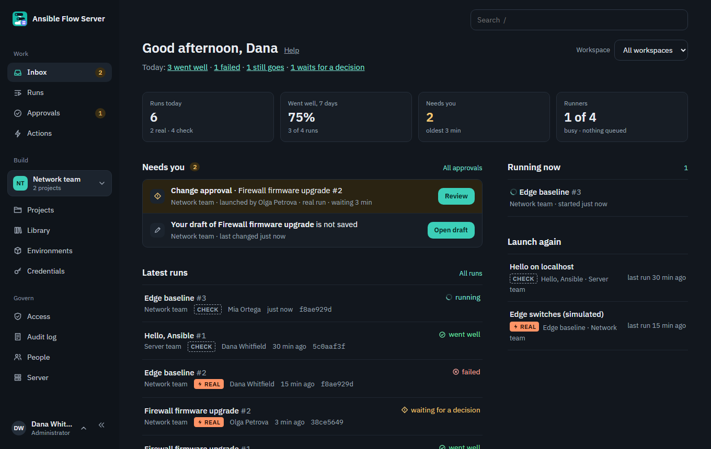
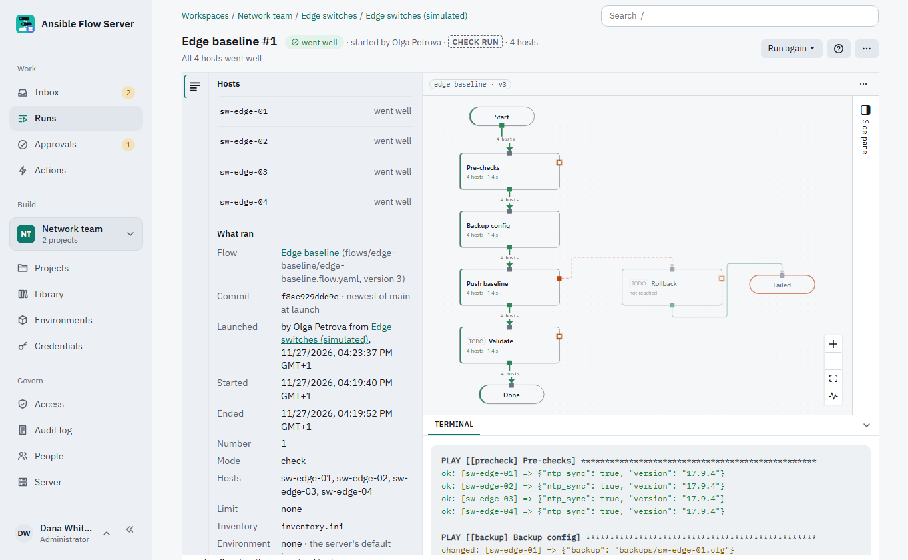

# Inbox and navigation

[The guide](README.md)

## Side menu

Once signed in, the side menu organizes everything into three groups plus your account menu (fold it
to a compact icon rail with **«** at the bottom; on phones it collapses into **Menu**):

- **Work** (spans _every_ workspace you can see):
  - **Inbox** (`/`): your daily triage home, badged with how many items need you.
  - **Runs** (`/runs`): all runs across workspaces, filterable by workspace, state, project, launch
    configuration and **Mine**.
  - **Approvals** (`/approvals`): gates waiting for a decision, badged with your pending count.
  - **Actions** (`/actions`): self-service [actions](actions.md) you can run (people with action-only
    access see **Actions** as their entire menu).
- **Build** (scoped to the **workspace switcher** at the top of the group): **Projects**,
  **Library** (shared subflows across all readable workspaces), **Environments** and
  **Credentials**. Switching workspaces keeps you on the same tab in the newly selected workspace.
- **Govern** (administrators): **Access** (for the selected workspace), **Audit log**, **People**
  (users, service accounts and groups) and **Server** (live overview linking Sign-in, Secret
  providers, Server certificate, Notifications, Event streaming and Default image).
- **Account menu** (your name at the bottom): **Profile**, **Access tokens**, **Theme** (dark,
  light, or follow device — the flow canvas adopts the page's palette automatically), **Help** and
  **Sign out**.

## Home inbox

**Inbox** (`/`) surfaces what needs your attention across all workspaces (use **Workspace** in the
top right to narrow to one workspace via `?workspace=<key>`):

- **Day summary**: runs today, 7-day success rate, items waiting on you, and active runner capacity.
- **Needs you**:
  - **Approvals** you may decide (**Review**).
  - **Paused runs** you started (**Continue**, **Step**, **Open**).
  - **Failed runs** of yours from the last 7 days until that configuration or flow runs again
    (**Open**, **Run again**).
  - **Unsaved drafts** you edited (**Open draft**, noting co-editors and whether the branch moved).
  - **Expiring server certificate** within 30 days, for administrators (**Replace**).
- **Waiting for others**, **Running now**, **Launch again** shortcuts, and **Latest runs**.

## Search, help and shortcuts

- **Quick search** (`/` or `Ctrl+K`, works even when the flow canvas is focused): jump to
  workspaces, projects, flows, launch configurations, runs (including `#12` by number),
  environments, actions, settings pages, and (for administrators) people and groups.
- **Contextual help**: click **Help** (or **?** on compact headers) on any page to open its guide
  section in a new tab. Everything in `/help/guide/` and `/docs/api` is served locally by the server
  with no internet dependency; external links note where they open.
- **Missing or restricted pages**: if you open a URL for something that does not exist or is not
  shared with you, the page names what was requested, links back to a page you can access, and lists
  administrators who can grant access.

| Keys                | Action                                                              |
| ------------------- | ------------------------------------------------------------------- |
| `/` or `Ctrl+K`     | Focus global search (`↑` / `↓` and `Enter` to open, `Esc` to clear) |
| `Ctrl+S` (`Cmd+S`)  | Submit the active form, or save a flow draft or file change         |
| `Ctrl+Enter`        | Launch a run from any field on the Launch form                      |
| `Ctrl+B` / `Ctrl+J` | Toggle left side bar / bottom panel on run and debug pages          |
| `Esc`               | Close open menu, dialog or full-screen canvas                       |
