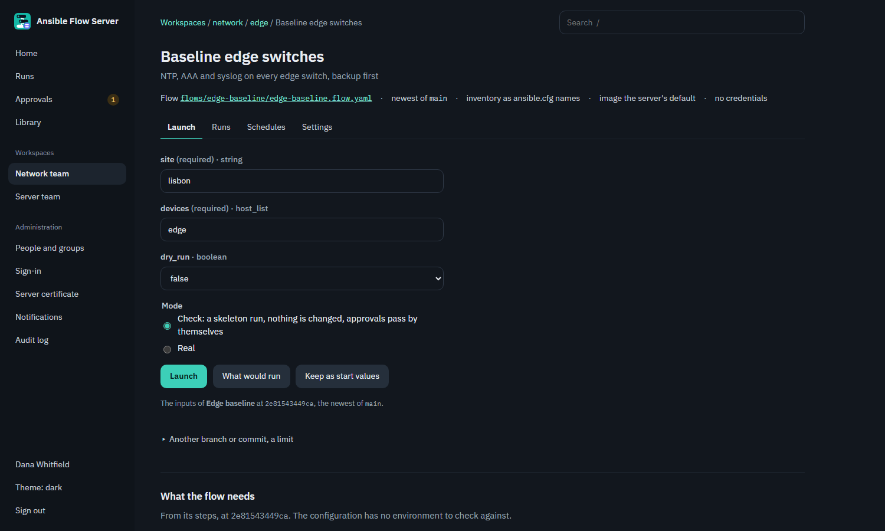

# Launch configurations

[The guide](README.md)



A launch configuration is a flow of a project with what a run of it needs, saved under a name.
A launch settles it into a run and puts the run in the queue ([Runs](runs.md)).

```sh
curl ... -X POST https://flows.example.net:8443/api/v1/projects/<project id>/launch-configs \
  -d '{"name":"Upgrade edge firewalls","flowFile":"flows/firewall-upgrade.flow.yaml",
       "inventory":"inventory/hosts.yaml","mode":"check",
       "inputs":{"devices":["fw-edge-01","fw-edge-02"]},"credentials":["<credential id>"]}'
curl ... -X POST https://flows.example.net:8443/api/v1/launch-configs/<id>/check \
  -d '{"mode":"real","inputs":{"target_version":"7.4.1"}}'
```

```json
{
  "launch": {
    "config": "0f3d6f0e-6a53-4d4e-8a55-9d2f0c1b7e21",
    "project": "2a968c91-1ac7-4654-94c8-2eb24a28b10b",
    "commit": "59b2575163b54f0c8a1e7d9b3f2a6c8e1d0b5741",
    "ref": "main",
    "flow": {
      "file": "flows/firewall-upgrade.flow.yaml",
      "key": "firewall-upgrade",
      "name": "Firewall firmware upgrade",
      "version": 1
    },
    "mode": "real",
    "inventory": "inventory/hosts.yaml",
    "inputs": {
      "devices": ["fw-edge-01", "fw-edge-02"],
      "target_version": "7.4.1",
      "backup_dir": "/srv/backups"
    },
    "targets": ["fw-edge-01", "fw-edge-02"],
    "credentials": ["7b1f6c0a-3c1e-4c58-9f0e-2f6a1d4b8e90"]
  }
}
```

| Setting       | Means                                                                       |
| ------------- | --------------------------------------------------------------------------- |
| `flowFile`    | The flow's file in the repository                                           |
| `gitRef`      | Another branch than the project's to take the newest commit of              |
| `commit`      | One commit, always (a pin). Not together with `gitRef`                      |
| `inventory`   | The inventory's path in the repository; left out: what `ansible.cfg` names  |
| `eeImage`     | The execution environment's image; left out: the server's default           |
| `mode`        | `check` (a skeleton run, the default) or `real`                             |
| `limit`       | Ansible's limit, for fewer hosts than the flow targets                      |
| `inputs`      | Start values of the flow's inputs. Never one that looks like a secret       |
| `credentials` | Credentials of the workspace a run gets (not a git token)                   |
| `notify`      | Whom its runs tell: `{"when": "failed" or "ended", "to": [logins, groups]}` |

| Address (under `/api/v1`)         | Does                                                       | Who                                  |
| --------------------------------- | ---------------------------------------------------------- | ------------------------------------ |
| `/projects/:id/launch-configs`    | List, each with its `lastRun`; add                         | read: `ro`; change: `rw` on the flow |
| `/launch-configs/:id`             | One, with its `lastRun`; change; delete                    | as above                             |
| `GET /launch-configs/:id/form`    | The flow's inputs as a form, with the start values         | `ro`                                 |
| `POST /launch-configs/:id/check`  | What a launch would run, or 422 with everything in its way | `ro`                                 |
| `POST /launch-configs/:id/facts`  | The hosts it would touch, as the inventory has them        | `operator`                           |
| `POST /launch-configs/:id/launch` | The same, and the run goes in the queue (201 with the run) | `operator`                           |

`lastRun` is the configuration's newest run among the runs you may see: `id`, `number`, `state`,
`createdAt`, and `endedAt` once it has ended. A configuration that has not run has none. A
project's list of flows says the same of each flow.

- **Saved only if it could run now:** the flow, the inventory, the branch or commit, each start
  value and each credential are checked; a refusal names the setting (`field`).
- **Which commit runs:** what the launch names (`ref` or `commit`), else what the configuration
  names, else the newest commit of the project's branch, after a look at the source.
- **At launch** a person may give `mode`, `ref` or `commit`, `limit`, and `inputs` as typed
  text (`"fw-edge-01, fw-edge-02"` is a host list). A secret-looking input is given here and is
  not repeated in the answer.

**On the pages:** a project's page lists its launch configurations. A configuration's page
shows its settings and the launch form:

- Check or real, and another branch or a commit; the form shows the flow's inputs at that
  commit, starting with the configuration's values.
- Secret-looking inputs are typed hidden and never kept.
- **What would run** shows the commit, the inputs as the flow gets them (secrets as `***`), the
  hosts it starts on, the inventory, image and credentials; what stands in the way is shown at
  its field.
- **Launch** (`operator` on the flow) queues the run and opens its page; another branch or
  commit than the configuration's needs `rw`.
- **Keep as start values** (`rw` on the flow) saves the typed values that are not secret as the
  configuration's.
- **Hosts in the inventory** (`operator`): under What would run, the hosts the targets match,
  the names the inventory does not have, and production-looking groups and hosts.

**The hosts, as the inventory has them** (`facts`): the server reads the inventory in the
launch's image, at the launch's commit, with the configuration's environment-variable
credentials (a dynamic source may need a token), the way the run will. It takes the same body as
`check`, and `"groups": true` adds the inventory's groups. Inputs that do not read yet are left
out; only a host list that does not read holds the hosts back.

```json
{
  "facts": {
    "sources": ["inventory/hosts.yaml"],
    "count": 2,
    "hosts": ["fw-edge-01", "fw-edge-02"],
    "unknown": ["fw-lab-09"],
    "uses": [],
    "prod": ["prod"],
    "vault": false,
    "environment": "registry.example.net/ee/network:2 (docker)"
  },
  "groups": ["edge", "lab", "prod"],
  "groupHosts": { "edge": { "count": 2, "hosts": ["fw-edge-01", "fw-edge-02"] } },
  "environment": "registry.example.net/ee/network:2 (docker)",
  "inventory": "inventory/hosts.yaml",
  "commit": "59b2575163b54f0c8a1e7d9b3f2a6c8e1d0b5741"
}
```

Without facts, `factsError` says why (no host typed, nothing matches, the image did not answer).
The image's container stays up two minutes after its last answer, so the next question is
quick; at most four are kept, and a stopping server removes them.
