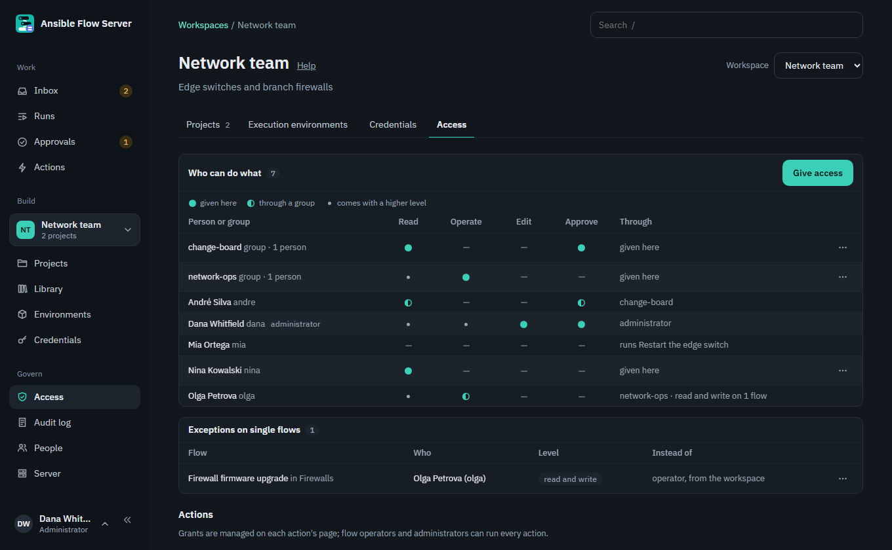

# People, groups and sign-in

[The guide](README.md)

A new server has no user. At start it writes a setup code to its log; the first administrator is
made with it, so by someone who can read the server's log:

```text
[09:44:38 13.11.2026] WARN  No user yet. Make the first administrator with this setup code (POST /api/v1/setup, or: user add --admin) setup=Jq3vN0c4TzWk
```

```sh
curl --cacert data/tls/certificate.pem --cookie-jar cookies.txt \
  -H 'content-type: application/json' https://flows.example.net:8443/api/v1/setup \
  -d '{"code":"Jq3vN0c4TzWk","login":"dana","name":"Dana Whitfield","password":"<a long passphrase>"}'
```

or, on the server's machine, with no code and the password typed unseen:

```sh
just user add dana --name "Dana Whitfield" --admin
```

| Address (under `/api/v1`)                                  | Does                                                                | Who                               |
| ---------------------------------------------------------- | ------------------------------------------------------------------- | --------------------------------- |
| `POST /session`                                            | Sign in with `{"login","password"}`                                 | anyone                            |
| `GET /session`                                             | Who am I, with my groups                                            | signed in                         |
| `DELETE /session`                                          | Sign out                                                            | anyone                            |
| `PUT /session/password`                                    | Change my password: `{"current","password"}`                        | signed in                         |
| `GET /session/access`                                      | My own access, workspace by workspace, and who gives access (below) | signed in                         |
| `PATCH /session`                                           | Change my `name` and `email`; `webhookUrl` only as an administrator | session (not a token)             |
| `GET /tokens`, `POST /tokens`                              | My access tokens; make one (shown once)                             | signed in; making needs a session |
| `DELETE /tokens/:id`                                       | Revoke one of my tokens                                             | signed in, with a session         |
| `/users`, `/users/:id`                                     | List, add, change, disable, delete people                           | administrators                    |
| `PUT /users/:id/password`                                  | Set someone's password                                              | administrators                    |
| `GET /users/:id/tokens`, `DELETE /users/:id/tokens/:token` | See and revoke someone's tokens                                     | administrators                    |
| `/groups`, `/groups/:id`                                   | List, add, change, delete groups                                    | administrators                    |
| `PUT /groups/:id/members`                                  | Set a group's members: `{"users":[ids]}`                            | administrators                    |
| `GET /users/:id/access`                                    | What one person reaches, workspace by workspace (below)             | administrators                    |
| `GET /groups/:id/grants`                                   | The grants that name a group, in every workspace (below)            | administrators                    |

- A password has at least 12 characters, at least 5 different ones, and does not contain the
  login. The pages say these rules under every password field and check them before sending. It
  is kept only as an argon2id hash.
- A session lasts 8 hours without use and 7 days at most. Its cookie is not readable by scripts
  and is sent over HTTPS only.
- After five wrong passwords for a login in fifteen minutes, sign-in for it waits.
- The last administrator cannot be demoted, disabled or deleted.
- A wrong login and a wrong password get one answer. A disabled account is told so (403
  `disabled`) only with its right password.
- `GET /users/:id/access` answers `{"admin", "workspaces"}`: a row for each workspace where a
  grant names the person or one of their groups, with the `workspace` (`id`, `key`, `name`),
  their `level` there, `approve`, the `flows` with a grant of their own (`project` key,
  `projectId`, `file`, `level`), and `through` (whose grants gave it: `user:omar`,
  `group:netops`). For an administrator it is `"admin": true` and no rows. `GET /session/access`
  is the same answer for whoever asks, about themself, with `administrators`: the names of the
  administrators, who give access. **My account** shows it under **Your access**. `GET /groups/:id/grants` lists the grants that name the group: each with the
  `workspace` (`id`, `key`, `name`), the `level`, and the `flow` when it is on one flow.
- A person and a group each have an email address and a webhook address: where a notification
  for them goes (see [Notifications](notifications.md)).

When nobody can sign in, the way back is the machine the server runs on:

| Command                                              | Does                                                        |
| ---------------------------------------------------- | ----------------------------------------------------------- |
| `user list`                                          | Everyone, with level, state and groups                      |
| `user add <login> [--name] [--email] [--admin]`      | Adds a person; the password is typed unseen, or piped       |
| `user password <login>`                              | Sets a password and ends that person's sessions             |
| `user disable <login>`, `user enable <login>`        | Disabling signs the person out                              |
| `user admin <login> on\|off`                         | Makes, or unmakes, an administrator                         |
| `user token <login> [--name] [--days] [--read-only]` | Prints a new access token for that person, and nothing else |

## Access tokens

A program (git, the VS Code extension, a pipeline) signs in with an access token, not a
password. A token is a person's and acts as that person. Make one while signed in:

```sh
curl --cacert data/tls/certificate.pem --cookie cookies.txt \
  -H 'content-type: application/json' https://flows.example.net:8443/api/v1/tokens \
  -d '{"name":"laptop git","expiresInDays":90,"readOnly":false}'
```

```json
{
  "id": "0b6f5c1e-8f0e-4d0a-9a53-6d0f8f1f2c77",
  "name": "laptop git",
  "hint": "Xk3Q",
  "readOnly": false,
  "createdAt": "2026-11-13T09:44:37.512Z",
  "expiresAt": "2027-02-11T09:44:37.512Z",
  "token": "afs_<43 characters, shown this once>"
}
```

and use it as a bearer, or as the password of HTTP Basic with any user name (what git sends):

```sh
curl --cacert data/tls/certificate.pem -H "Authorization: Bearer $AFS_TOKEN" \
  https://flows.example.net:8443/api/v1/workspaces
```

- The server keeps a hash of the token: it cannot show it again. Lost means revoke and make anew.
- A token lasts 90 days unless you say otherwise, a year at most. It stops when it is revoked,
  at its end, and while its owner is disabled. A person has at most 50.
- A read-only token (`"readOnly": true`) reads and changes nothing: a change is refused
  (`403 read_only_token`) before what it sent is looked at.
- An agent with a token made with `"mcpApprovals": true` may decide approvals over MCP (see
  [Agents (MCP)](api-and-mcp.md#agents-mcp)); without it approvals stay with people. Not for a read-only token.
- A token for one workspace (`"workspace": "net"`, its key or id) reaches that workspace only:
  its projects, flows, credentials, launch configurations, runs and git repositories. What spans
  workspaces (the list of workspaces, all runs, people, the audit log) is refused with
  `403 out_of_scope`; list runs with `?project=<id>`.
- A token cannot make or revoke tokens, or set a password: those take a signed-in session.
- Keep it in an environment variable or a credential store, never in a repository or an address.

**Sign in with your organisation (OIDC):** Keycloak, Microsoft Entra ID, Google, Okta, Authentik
and any other OpenID Connect provider. On the Sign-in page (Administration, `/admin/sign-in`) an
administrator adds a provider:

| Setting       | What                                                                                      |
| ------------- | ----------------------------------------------------------------------------------------- |
| Name, key     | The button's words; the key is in the sign-in address (`keycloak`)                        |
| Issuer        | `https://login.example.net/realms/net`; `https://login.microsoftonline.com/<tenant>/v2.0` |
| Client id     | The client registered at the provider for this server                                     |
| Client secret | Kept sealed with the master key, never shown again; empty for a public client             |
| Scopes        | `openid profile email` by default; add what the groups claim needs                        |
| Groups claim  | The claim with the person's groups (`groups`)                                             |
| Login claim   | A new person's login (`preferred_username`; else the email, else the subject)             |
| Mappings      | A value of the groups claim and what it is here: a server group, or administrator         |

Register the address the page shows (`https://flows.example.net/api/v1/auth/oidc/<key>/callback`)
as the client's redirect URI at the provider, and Test the provider. The address shows while the
provider is added, as soon as its key is typed. Then:

- The sign-in page has a button per provider. The sign-in is the authorization code flow with
  PKCE, state and nonce; the ID token's signature, issuer and audience are checked.
- A person is made at their first sign-in (no password: they sign in at the provider) and found
  again by their subject there. Their name and email follow the provider.
- At each sign-in their groups and the administrator right follow the mapped claim values: what the
  provider no longer says is taken back. Groups and rights given here by hand are kept.
- **Passwords for administrators only:** the page's Passwords setting lets everyone else sign in
  only with a provider (a way in stays if the provider is down). It asks first, and is refused
  (409) while no provider or directory is enabled: nobody else could sign in.
- Removing a provider keeps its people; the groups and administrator rights it gave go.
- A provider's certificate authority: `AFS_CA_FILE`. Every change is in the audit log.

**Sign in with a directory (LDAP, Active Directory):** people type their directory login and
password in the usual sign-in form. On the same Sign-in page an administrator adds a directory,
starting from the Active Directory or the OpenLDAP preset:

| Setting                | What                                                                                                                     |
| ---------------------- | ------------------------------------------------------------------------------------------------------------------------ |
| Address                | `ldaps://dc1.corp.example.net:636`; `ldap://` only with StartTLS (or on this machine)                                    |
| Service account        | The DN that searches (`CN=svc-flows,OU=Services,DC=corp,DC=example,DC=net`) and its password, sealed with the master key |
| Where people are       | The search base (`OU=Staff,DC=corp,DC=example,DC=net`)                                                                   |
| Person filter          | `(&(objectCategory=person)(objectClass=user)(sAMAccountName={login}))`                                                   |
| Id, login, name, email | Attributes; the id stays the same when a person is renamed (`objectGUID`, `entryUUID`)                                   |
| Groups from            | A search (`(&(objectClass=group)(member:1.2.840.113556.1.4.1941:={dn}))`: nested AD groups too) or `memberOf`            |
| Disabled in AD         | People disabled in Active Directory cannot sign in                                                                       |
| Sync every             | Minutes (60 by default; 0: only at sign-in)                                                                              |
| Mappings               | A group's name (`netops`) or DN and what it is here: a server group, or administrator                                    |

Test it, with a login if you like: the page shows the entry found, its groups and what they are
here. Then:

- A login with a password here signs in here; any other login is tried with the directories, in
  order. A wrong password is refused there and then; a directory that does not answer is skipped.
  Every refusal says the same thing.
- A person is made at their first sign-in and found again by their id in the directory. Their
  name, email, groups and administrator right follow the directory, as with a provider: what was
  given here by hand stays.
- **The sync** looks everyone up again on the timer (and with Sync now): who left the directory, or
  was disabled in Active Directory, is disabled here, and their open sessions and tokens stop at
  once. Who comes back is enabled again. A directory that does not answer disables nobody; an
  account disabled here by hand stays disabled.
- Directory sign-ins also work when passwords are for administrators only.
- Removing a directory keeps its people; the groups, rights and disabling it gave go.
- The directory's certificate authority: `AFS_CA_FILE`. Every change and sync is in the audit log.

Not there yet: GitHub sign-in (OAuth 2, not OIDC); Kerberos (sign-in without typing a password).

## Access levels



Administrators may do everything. Everyone else sees and does only what they are given: a
**grant** gives a user or a group a level on a whole workspace, or on one flow of it.

| Level      | May                                                                                                                                       |
| ---------- | ----------------------------------------------------------------------------------------------------------------------------------------- |
| `ro`       | See the workspace, its projects, flows, launch configurations, credentials (names) and runs; clone and fetch; ask what a launch would run |
| `operator` | And launch a flow as its launch configuration says; stop a run, run it again                                                              |
| `rw`       | And launch another branch or commit; add, change and delete launch configurations; push through the server; look at the source now        |
| `approve`  | Decide approval gates, and see what they decide (as `ro`); a grant of its own, which never lowers another                                 |

- **A grant on one flow replaces the workspace's for that flow:** it may give more (operator on
  one flow of a workspace that is ro) or less (ro on one flow of a workspace that is rw).
- **Of a person's own and their groups' grants, the highest counts.**
- **Git is the workspace's:** clone needs `ro` on the workspace and push `rw` on it; a grant on
  one flow does not open the repository, which holds every flow.
- **What a person may not see is not there for them:** lists leave it out, and asking for it
  answers 404 with the words a missing one gets ("No such run"). What they may see but not do answers 403.
- **Tokens act as their owner,** narrowed further when read-only or made for one workspace.
- Workspaces, projects, credentials and grants are changed by administrators.
- **The pages say the levels in words:** read only, operator, read and write, approver. Each
  workspace and every tab of a project says your own access there under its title, with the
  flows a grant of your own gives another level on, by their titles.

Give and take grants on the workspace's page (Access), or:

```sh
curl --cookie cookies.txt -H 'content-type: application/json' \
  https://flows.example.net:8443/api/v1/workspaces/net/grants -d '{"group":"net-ops","level":"operator"}'
curl --cookie cookies.txt -H 'content-type: application/json' \
  https://flows.example.net:8443/api/v1/workspaces/net/grants \
  -d '{"user":"omar","level":"rw","project":"<project id>","flow":"flows/firewall-upgrade.flow.yaml"}'
```

| Address (under `/api/v1`)            | Does                                                                                         | Who            |
| ------------------------------------ | -------------------------------------------------------------------------------------------- | -------------- |
| `GET`, `POST /workspaces/:id/grants` | A workspace's grants; give one (`user` or `group`, `level`, optionally `project` and `flow`) | administrators |
| `DELETE /grants/:id`                 | Take a grant back                                                                            | administrators |
| `GET /workspaces/:id/access`         | Who can do what: every person with access, as their grants come out                          | administrators |
| `GET /projects/:id/access`           | What you may do in a project: your level on it and on each flow                              | can see it     |

## Service accounts

A pipeline or another program gets an identity of its own: a service account. It has no
password and cannot sign in to the pages; it signs in only with tokens, which an administrator
makes for it (signed in with a password). What it may do is what its account may do:

```sh
# as an administrator, signed in to the pages (cookie) or on the server's machine
curl --cookie cookies.txt -H 'content-type: application/json' \
  https://flows.example.net:8443/api/v1/users -d '{"login":"ci-pipeline","name":"CI pipeline","service":true}'
curl --cookie cookies.txt -H 'content-type: application/json' \
  https://flows.example.net:8443/api/v1/users/<id>/tokens -d '{"name":"nightly","workspace":"net"}'

just user add ci-pipeline --service
just user token ci-pipeline --name nightly --workspace net --days 30
```

Its tokens are listed and revoked like anyone's (`GET`/`DELETE /api/v1/users/<id>/tokens`). On
the pages, an administrator adds a service account at Administration > People and groups and makes
its tokens on its page.
A service account is given levels like a person (see [Access levels](#access-levels)).
