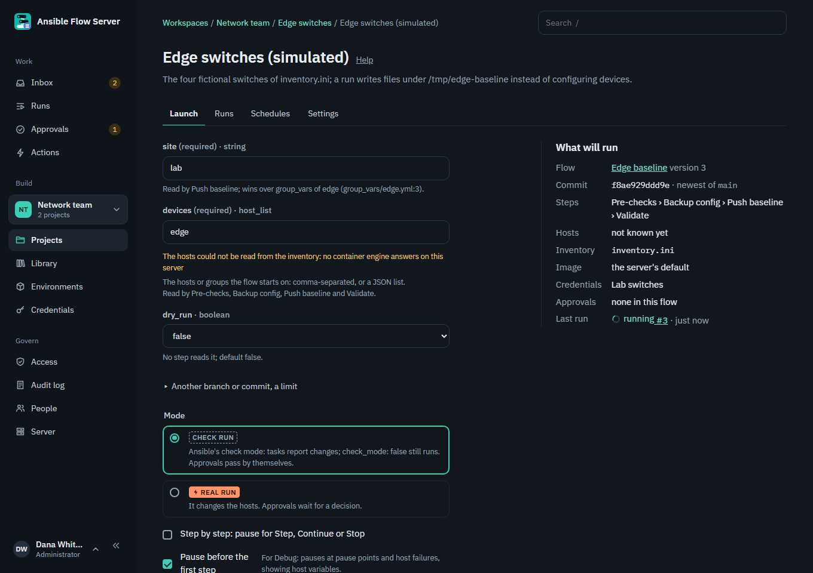
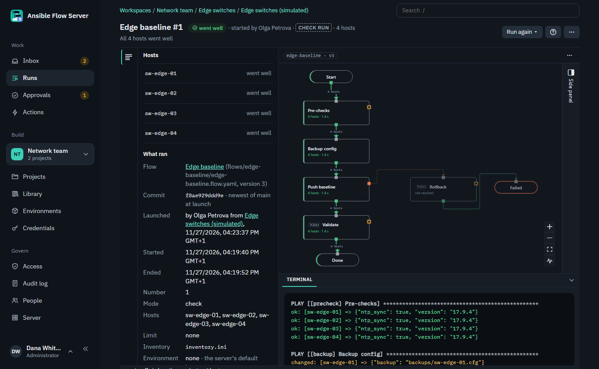

# Run playbooks

[The guide](README.md)

Flows run in execution environment containers (Docker or Podman) using the same runner as
[Ansible Flow Designer](https://github.com/ChistokhinSV/ansible-flow-designer), with fresh Ansible
playbooks generated from the flow at the run's Git commit.

## Launch configurations

A **launch configuration** binds a flow to everything needed to run it repeatedly under a clear
name. Operators (`operator` or higher) launch it; editors (`rw` on the flow) create and change it on
the project's **Overview** (**Add a launch configuration**).

| Setting             | What it sets                                                                                           |
| ------------------- | ------------------------------------------------------------------------------------------------------ |
| **Flow**            | Path to `*.flow.yaml` in the project (flows with validation errors cannot launch)                      |
| **Branch / Commit** | Defaults to the newest commit on the project's branch; optionally pin a branch or commit               |
| **Inventory**       | Inventory path in the repository (defaults to what `ansible.cfg` configures)                           |
| **Environment**     | Workspace [execution environment](environments.md) or image (defaults to the server default)           |
| **Mode**            | **Check** (default) or **Real**                                                                        |
| **Limit**           | Optional Ansible `--limit` host pattern                                                                |
| **Inputs**          | Default values for the flow's inputs (secret-looking inputs are typed at launch, never saved)          |
| **Credentials**     | Workspace [credentials](credentials.md) mounted for the run (SSH, login, become, vault, env, registry) |
| **Notify**          | Users or groups [notified](notifications.md) when a run fails or whenever it ends                      |

### Launching a run

Open a launch configuration's **Launch** tab (or click **Run** directly on a flow's canvas):

- **Check vs Real**:
  - **Check** runs Ansible's `--check` mode (tasks report what they would change; tasks marked
    `check_mode: false` still execute) and passes [approval gates](approvals.md) automatically.
  - **Real** applies changes on target hosts and pauses at approval gates for human sign-off.
- **What will run**: updates live beside the form as you type — showing the flow version and commit,
  expected step path, matched inventory hosts (with group quick-pick buttons and warnings for
  unknown hosts or empty limits), image, credentials, upcoming approvals and the last run. Under
  each input, a precedence note shows which steps read it and which `group_vars` / `host_vars`
  definitions it overrides.
- Press **Launch check run** or **Launch real run** (`Ctrl+Enter` / `Cmd+Enter` from any field). Use
  **Keep as start values** (`rw`) to save non-secret form edits back to the configuration. Running a
  different branch or commit than the configuration's requires `rw`.

## Watching a run

Queued runs execute up to `AFS_MAX_RUNS` (default `4`) across the server and
`AFS_MAX_RUNS_PER_PROJECT` (`1`) per project. Each state pairs a distinct icon shape with text so it
reads without colour, and **Real** (solid) vs **Check** (dashed) badges distinguish modes everywhere.

On the run's page (`/runs/<id>`):

- **Canvas**: updates live as hosts move along wires (`ok_hosts`, `failed_hosts`, `approved`). Click
  any step to inspect per-host task results and recorded step input values (secrets are always
  redacted).
- **Left side bar (`Details`)**: shows **Approvals** waiting for a decision, **Hosts** (problem
  hosts first), flow **Outputs**, and **What ran** (commit, image, credentials, inputs and any
  targets skipped because they were not in the inventory). Press `Ctrl+B` to fold the side bar.
- **Bottom panel**: **Terminal** streams ANSI-coloured Ansible output (secrets masked) and
  **Problems** lists host failures. Press `Ctrl+J` to fold the panel.
- **Stop**: cancels a queued run immediately or stops a running flow at the worker's next step
  (stopping a real run or someone else's step run asks to confirm). Runs exceeding
  `AFS_RUN_TIMEOUT_MINUTES` (`240`) stop automatically.

## Run again

Once a run has ended, operators can open **Run again ▾** in its header:

- **Run again**: starts a new run at the same commit, inputs, mode and limit (approvals are asked
  afresh).
- **Change and run…**: opens the configuration's **Launch** tab pre-filled from this run, noting
  anything that differs from saved defaults (re-enter any secret inputs).
- **Only the N hosts that did not go well**: re-runs only `failed`, `unreachable` and `stopped`
  hosts via a safe per-host limit file. Before starting, a prompt warns how a host limit affects the
  flow (`localhost` / controller plays are skipped unless included, and `run_once`, failure
  percentages and rolling batches count only the limited hosts).
- **Debug this failure…** (`rw`, or operators when allowed): launches those problem hosts in check
  mode under the [debugger](debugging.md), pausing right before the step where they failed.

## Step by step

Tick **Step by step** on the **Launch** tab (or choose **Run ▾ › Run Step by Step** on the canvas)
to pause a single Ansible run before each step — or only at your **pause points** (click the dot at
a step's top-left corner or right-click the step). Facts and registered variables carry across steps.

- Use **Step** (`F10`), **Continue** / **Pause** (`F8`), or **Stop** above the canvas.
- Unanswered pauses stop automatically after `AFS_RUN_STEP_TIMEOUT_MINUTES` (`60` min by default),
  and paused runs cannot resume across a server restart.
- To inspect host variables, evaluate Jinja and retry failed steps during a pause, use
  [Debug a run](debugging.md).

## Dev runs

With `rw` on a workspace, you can test local, uncommitted edits from VS Code before pushing: in
[Ansible Flow Designer](https://github.com/ChistokhinSV/ansible-flow-designer), run **Check My Work
on Server**. The extension uploads a temporary Git bundle kept under an isolated ref for
`AFS_DEV_KEEP_HOURS` (`24` h, never exposed on branches or pushed upstream) and runs it in **Check**
mode only, marked **dev** in the run list.

For programmatic launches, SSE event streams and relaunch payloads, see the
[API reference](/docs/api) and [REST API and agents (MCP)](api-and-mcp.md).
