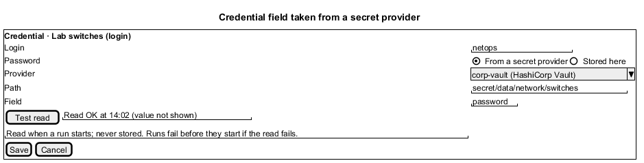

# Secret providers

[The guide](README.md)

A credential can keep its secret here, encrypted with the master key (see
[Credentials](credentials.md)), or **take it from a secret provider** your organisation already
runs. The server then reads the value when a run starts, uses it for that run only, and never
writes it anywhere.

| Kind                | Signs in with                                      | A reference names                                                             |
| ------------------- | -------------------------------------------------- | ----------------------------------------------------------------------------- |
| HashiCorp Vault     | AppRole (role id and secret id), or a token        | KV version 2: mount, path, field, version                                     |
| CyberArk Conjur     | A host and its API key                             | A variable                                                                    |
| CyberArk CCP        | An application id (AppID) and a client certificate | Safe, folder, object, field (`Content` by default)                            |
| AWS Secrets Manager | An access key (and a session token if it has one)  | A secret's name or ARN; a key of a JSON secret, or all of it; a version stage |

## Add a provider

**Administration › Secret providers › Add a provider**. Administrators only.

1. Choose the kind and give it a name (people see it in the credential form and in a run's
   output) and a key (credentials name it by its key).
2. Its address: `https://vault.example.net:8200`. For AWS, the region (`eu-central-1`); the
   address is only for an endpoint other than the region's, such as a VPC endpoint.
3. **Certificate authority**: only when the provider's certificate is not from an authority the
   server already trusts (the system's, and `AFS_CA_FILE`). It is trusted for this provider only.
4. Its own settings and its secret part:
   - Vault: **Sign in with** AppRole or a token; the AppRole mount (`approle`), a namespace
     (Enterprise), the KV mount references read by default (`secret`).
   - Conjur: the account and the host's login (`host/afs`), and the host's API key.
   - CCP: the application id and, when CCP checks the client, the client certificate and its key.
   - AWS: the access key id and secret access key. Assuming a role is not offered yet.

   The secret part is sealed with the master key and never shown again. **Replace** sends a new
   one; rotating the master key reseals it with the rest.
5. **Workspaces that may use it**: only credentials of those workspaces may read from it.

**Test the provider** signs in (Vault, Conjur, AWS) or reaches it with the client certificate
(CCP). Give a reference too and it reads that secret; the value is never shown.

A provider cannot be removed, change its key, or close a workspace while a credential reads from
it: the refusal names that credential.

## Take a credential's secret from a provider

On a workspace's **Credentials**, an administrator adding or changing a credential chooses, for
each secret part (a password, a private key, a token, a variable's value), **Stored here** or
**From a secret provider**. The form offers the providers open to the workspace.



- Name the provider and where the secret is: for Vault the path (`network/switches`, without
  `data/`) and the field (`password`).
- **Test read** reads it now and says whether it could: "Read OK at 14:02 (value not shown)".
- Saved, the credential holds the reference, not the value.

Who sees what:

- The workspace's administrators (read and write on it) see where each part is read from:
  `password from Corp Vault (network/switches#password)`.
- Others see which provider only: `password from Corp Vault`.

## When a run reads them

- Once, when the run really starts: after its approval, or at its schedule's time; not when it is
  asked for. A run that waits at an approval reads again when it goes on.
- Each provider is signed in to once per run. A Vault token the run got with AppRole is revoked
  when the run ends.
- A read that fails ends the run **failed before any container starts**, with words that name the
  credential, the provider and what went wrong, never the path:

  ```text
  Cannot read the credential "Lab switches" (password): HashiCorp Vault refused the read (403): "Corp Vault" may not read this secret
  ```

  Conjur answers the same for a variable that is not there and one it may not read: "no such
  variable, or "conjur-prod" may not read it". The provider's own message, which names the path,
  goes only to the server's log.
- Values read are hidden from the run's output and from its events, like stored secrets. A JSON
  secret is hidden whole and value by value.
- The run's output says where each part came from:
  `Credential: login "Lab switches" as netops, password from HashiCorp Vault "Corp Vault"`.
- Every read is in the audit log as `secret-provider.read`, with the run, the credential and how
  it went; tests are `secret-provider.test` and `credential.test-read`.

A project's git credential and an inventory that needs a run's variables read the same way, once
per use.

## The API

| Address (under `/api/v1`)          | Does                                                   | Who            |
| ---------------------------------- | ------------------------------------------------------ | -------------- |
| `/admin/secret-providers`          | List; add                                              | administrators |
| `/admin/secret-providers/:id`      | One (with the credentials that use it); change; remove | administrators |
| `/admin/secret-providers/:id/test` | Sign in; with `ref`, read it too (never the value)     | administrators |
| `/workspaces/:id/secret-providers` | The providers open to the workspace                    | administrators |
| `/workspaces/:id/secret-refs/test` | Test read of a reference                               | administrators |

A credential takes parts from providers with `refs`, by part name:

```sh
curl ... -X POST https://flows.example.net:8443/api/v1/workspaces/network/credentials \
  -d '{"name":"Lab switches","kind":"login","fields":{"username":"netops"},"secret":{},
       "refs":{"password":{"provider":"corp-vault","path":"network/switches","field":"password"}}}'
```

| Kind     | Parts of a reference                  |
| -------- | ------------------------------------- |
| `vault`  | `mount`, `path`, `field`, `version`   |
| `conjur` | `variable`                            |
| `ccp`    | `safe`, `folder`, `object`, `field`   |
| `aws`    | `secretId`, `jsonKey`, `versionStage` |

`PATCH /credentials/:id` with `refs` replaces them whole; `"refs": null` drops them (store the
parts then, with `secret`).
