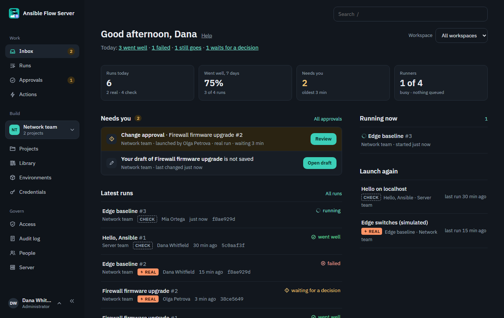
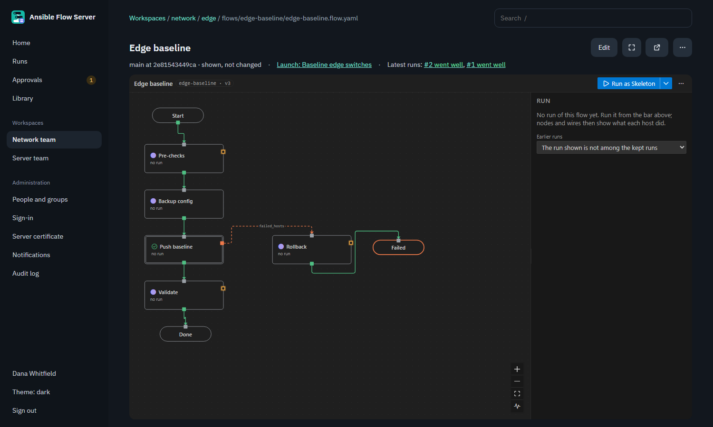
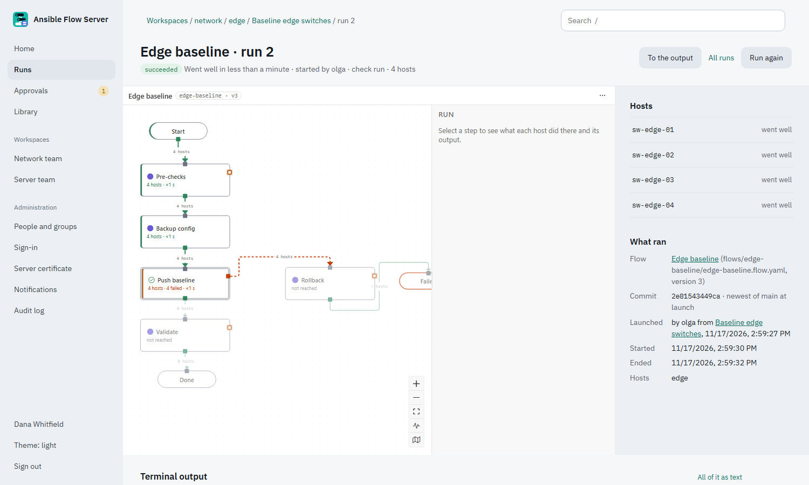

# The web pages

[The guide](README.md)







The server serves its own pages at its address. A new server shows the first-run setup (the
setup code from its log); after that, sign-in: a card over a quiet picture of a flow, which says
nothing about the server (the page is public). Signed in, a side menu leads to Home, Runs,
Approvals (with how many wait for you), Library, each workspace and, for administrators, the
administration's pages; **Help**, your name, the theme and Sign out are at its end. **Help**
(`/help`) lists this guide's pages and the API reference, and most pages link the guide page
about them with **Help** beside their title. The server shows this guide itself, as it was for its
version, at `/help/guide/<page>`: it needs no internet. A link in it that leaves the server says
where it goes (GitHub). A page that is not there, or not shared with you (a workspace, a project, a
flow, a run, a launch configuration), says what was looked for, a way back to a page you can open,
and which administrators give access. Long pages are split into tabs; each tab has its own
address. At phone width it folds into **Menu**. On a wider screen **Fold the menu** (the « icon at
its end) folds it to a rail of icons, each with its name as a tooltip: Home, Runs, Approvals (with
its count), Library, **Workspaces** and **Administration** (each a menu of its pages, scrolling
when long; arrows go through it, Esc closes it), Help, your account, the theme and Sign out.
» unfolds it. The browser keeps the choice. Ctrl+S (Cmd+S) submits the form you are typing in,
or the page's only form (never one that deletes), and saves a flow's draft while you edit it; it
never opens the browser's Save dialog.

| Page                                              | Shows                                                                                                                                                                                                                                                              |
| ------------------------------------------------- | ------------------------------------------------------------------------------------------------------------------------------------------------------------------------------------------------------------------------------------------------------------------ |
| `/`                                               | Home: the day in a sentence, the approvals waiting for you, the launch configurations you used lately (Launch again), the latest runs, the workspaces                                                                                                              |
| `/workspaces`                                     | The workspaces; administrators add one                                                                                                                                                                                                                             |
| `/w/<workspace>`                                  | A workspace in tabs. **Projects**: its projects; administrators add one, kept by the server or external (with what it signs in with)                                                                                                                               |
| `/w/<workspace>/-/environments`                   | **Execution environments** of the workspace                                                                                                                                                                                                                        |
| `/w/<workspace>/-/credentials`                    | **Credentials** of the workspace (administrators add, change, delete)                                                                                                                                                                                              |
| `/w/<workspace>/-/access`                         | **Access** (administrators): who can do what, the grants, giving access, who decides a launcher's own approvals                                                                                                                                                    |
| `/w/<workspace>/<project>`                        | A project in tabs, with its state in one line under the title (source, branch, commit). **Overview**: launch configurations with their last run and Launch, flows with their findings and how their last run went, the newest runs                                 |
| `/w/<workspace>/<project>/runs`                   | **Runs** of the project                                                                                                                                                                                                                                            |
| `/w/<workspace>/<project>/files`                  | **Files** of the project                                                                                                                                                                                                                                           |
| `/w/<workspace>/<project>/history`                | **History**: the commits of a branch, a filter, a commit opens to the files it changed                                                                                                                                                                             |
| `/w/<workspace>/<project>/branches`               | **Branches** and who pushed through the server                                                                                                                                                                                                                     |
| `/w/<workspace>/<project>/settings`               | **Settings**: the `git clone` command, what an external source signs in with, its SSH host key, the push hook, library                                                                                                                                             |
| `/w/<workspace>/<project>/flow/<file>`            | One flow on the designer's canvas; its launch configurations (Launch) and newest runs above it; "Open on its own page"                                                                                                                                             |
| `.../flow/<file>?commit=<hash>`                   | The flow as that commit left it, read only, in the Changes lens against the version before                                                                                                                                                                         |
| `/w/<workspace>/<project>/launch/<id>`            | A launch configuration in tabs. **Launch**: the form, Check or Real as a choice, What will run beside it, the button that names the run, what would run, keep start values                                                                                         |
| `.../launch/<id>/runs`, `/schedules`, `/settings` | Its **Runs** (older ones a page at a time), its **Schedules**, and its **Settings** (change, delete; `rw` on its flow)                                                                                                                                             |
| `/w/<workspace>/<project>/launch/new`             | Add a launch configuration (`rw` on its flow)                                                                                                                                                                                                                      |
| `/runs`                                           | Every run you may see, the newest first, filtered by state, by project and one of its launch configurations, and to your own (Mine); the choices are in the address; older runs a page at a time                                                                   |
| `/runs/<id>`                                      | One run: where it belongs (workspace, project, launch configuration), where it stands in a sentence, the run on the canvas, beside it the approval that waits, its hosts (those with a problem first), why one failed and what ran; its output; Stop and Run again |
| `/approvals`                                      | What waits for a decision: yours each in a tinted box with the decision (and a comment), others' as rows with why not                                                                                                                                              |
| `/docs/api`                                       | The API reference, from the server's OpenAPI document: Test Request as you or a pasted token                                                                                                                                                                       |
| `/account`, `/account/tokens`                     | Your **Profile** (name, email address; webhook for administrators) and your **Access tokens**                                                                                                                                                                      |
| `/admin/people`, `/admin/groups`                  | **People** (filtered by name and kind) and **Groups**, each a tab; add a person, service account or group                                                                                                                                                          |
| `/admin/people/<id>`                              | One account: groups, what they reach in each workspace, profile, password, tokens (made here for a service account); disable and delete last                                                                                                                       |
| `/admin/groups/<id>`                              | One group: members, the workspaces that name it, name, email address and webhook, delete                                                                                                                                                                           |
| `/admin/sign-in`                                  | Sign-in providers, directories, who may use a password                                                                                                                                                                                                             |
| `/admin/certificate`                              | The server certificate: in use and its days left, the one before (roll back), history; replace it by a request, a certificate or a PFX file; new self-signed                                                                                                       |
| `/admin/notifications`                            | The delivery log; `/admin/notifications/settings`: the mail server, the webhook signing key, a test message                                                                                                                                                        |
| `/admin/audit`                                    | The audit log, filtered, older entries a page at a time; export as CSV or JSON                                                                                                                                                                                     |

- **Search** at the top of every page (`/` or Ctrl+K): as you type, the workspaces, projects, flows (by name,
  key or file), launch configurations, runs (by number, flow or configuration), environments and
  pages the person may see; people and groups for administrators. Arrows and Enter open one, Esc
  empties the field. `/` and Ctrl+K work while the flow canvas has the focus too. The same over the API: `GET /api/v1/search?q=` (a token made for one workspace searches
  there only).
- Dark by default; the theme button in the side menu goes to light, then to following the device.
  The flow canvas keeps the designer's own look in the same theme.
- **A run's state** has a shape of its own beside its words, so it reads without colour: a dashed
  circle for queued, a turning arc for running, two bars for paused, a diamond for waiting for a
  decision (the approval's shape on the canvas), a tick for went well, a cross for failed, a
  diamond with a cross for rejected or not decided in time, a square for stopped and a broken
  circle for lost. With reduced motion set on the device, the arc does not turn.
- **Real and check runs** look different wherever runs are listed and on a run's page: a real run
  has a solid **Real** badge, a check run a dashed **Check** badge. A real run's page has a
  striped line along the top of its header.
- Works at phone width and with a keyboard and a screen reader. At phone width a table shows each
  row as a card, each value named by its column, with the row's buttons under it. After a page change the focus is
  on the new page's title; Esc closes the phone menu.
- A flow is shown as in VS Code (levels, details, generated code) and cannot be changed here.
- **Where a value comes from** works as in VS Code, with the repository's variables at the commit
  shown (the flow's, a run's, a draft's start): a variable's tooltip and **Details › Data** list
  every place that sets the name, with its precedence, and the one that wins for the host picked in
  **For host** (the inventory's hosts, or the run's). The inventory is the run's on a run's page;
  elsewhere the one the flow's launch configurations name, when they agree, else what ansible.cfg
  names. A definition's file and line opens the **Files** tab at that line in a new tab. It needs
  `ro` on the project (as the Files tab); with access to one flow only, the canvas says where a
  value comes from in the flow alone. Over the API: `POST /api/v1/projects/<id>/vars` with
  `{"commit": "<hash>", "inventory": "inventory/hosts.yml", "roles": [], "files": []}` gives the
  index (`defs` by name, each with `file`, zero-based `line`, `rank` and a value when it is not
  secret; `hosts`; `groups`).
- **When someone changes a flow you have open** (a push, through the server or to the source the
  server looks at), a bar on the canvas says who and how much ("Mia Ortega changed this flow: 3
  steps"). **Show changes** opens the new version in the Changes lens, compared with the one you
  had; **Update** just shows the new version. A flow removed from the branch is said so and stays
  as it was. The Changes lens also compares with any earlier commit that changed the flow. A
  project's page lists the flows changed while it is open, and by whom. Over the API:
  `GET /api/v1/projects/<id>/events` (server-sent events: `commit`, then `moved` with from and to),
  `GET /api/v1/projects/<id>/changes?from=<commit>` (the flows added, changed or removed, and who
  changed them) and `GET /api/v1/projects/<id>/flows/history?path=` (the commits that changed a
  flow).
- A run is shown on the canvas as in VS Code, live while it goes; a step's host output, the flow's earlier runs and Stop work from the canvas, and an approval is decided in its Run tab.
- Run on the canvas opens the designer's launch dialog over a launch configuration of the flow (pick one when there are several): its start values, the inventory's groups, and the hosts the targets match, counted again as you type. Run launches it (`operator` on the flow) and the run shows on the canvas.
- Administrators read the audit log at `/admin/audit` and export it.
- A project's page lists its launch configurations; `rw` on a flow adds, changes and deletes
  them.
- A workspace's Access tab is for administrators: who can do what, and the grants.
- Each page shows only what the person's level lets them do; the server decides either way.
- Administrators manage people and groups at `/admin/people`. The server's rules stand there too
  (the last administrator stays one; nobody disables or deletes themself), and a refusal is shown
  as the server words it.

## Editing flows in the pages

Someone with `rw` on a flow edits it on its page: **Edit** opens the designer in full, as in VS
Code. Everyone who edits the same flow edits one shared draft:

- **Edits are shared at once.** Each change goes to the server, which applies it to the draft in
  the order it gets them, and everyone's canvas shows the result. Changes to different steps all
  apply; when two people change the same field, the later one wins. A step's binding you have
  open follows what someone else changes in it: only the parameters you changed are yours. The
  canvas sits right under the flow's title and its buttons (**Save**, **Stop editing**,
  **Discard**); **i** beside Full screen says which commit of which branch the draft is of. Beside
  the buttons, who is here shows as chips of initials (the name on hover; a tab you closed leaves
  at once) with what happened last ("Mia Ortega changed the timeout of Backup, 3 times");
  **N earlier** lists the ones before (Escape or a click elsewhere closes it), and **main moved**
  says what changed on the branch. What must be read whole (someone about to save or discard, an
  error, what an import or a sample added) is a bar across the page over the canvas.
- **Ctrl+Z takes back your own last edit**, says what it was (a step's fields, a note's text), and
  leaves the others' alone.
  When someone changed the same place after you, it is refused with what they changed.
  **Ctrl+Y** (or Ctrl+Shift+Z) brings back what Ctrl+Z took, one edit at a time, until you make a
  new edit; it is refused the same way when someone changed that place since.
- **Save** (or Ctrl+S, on the page or in the canvas) opens a dialog: what the draft changes, place
  by place in the forms' words, with who changed each, the steps moved on the canvas and by whom,
  and the files a sample adds, and the commit message made of it (whole changes, then "and N
  more"). The dialog stays current while it is open, also with what others change meanwhile; the
  message follows it until you type your own.
  Save then makes one commit on the project's branch, with that message, by you, and
  `Co-authored-by` for everyone else who edited; it then says the commit (a link to the flow at
  it) and the co-authors. While the draft changes nothing (no edit yet, or every edit taken
  back) **Save** is off and Ctrl+S says there is nothing to save. A commit's details on the
  **History** tab name its co-authors without their e-mail addresses. For a project with an external repository the commit is pushed there
  first, only if the branch there has not moved. When the branch moved since the draft began, the
  draft is merged onto it step by step first; each place both changed is listed with the draft's
  value and the branch's, you pick which to keep at each, and **Save with these** saves. When
  someone changes the draft while you choose, the save stops and lists the places again with the
  values as they are now. While you edit, the line says when the flow is changed or removed on
  the branch (a push from VS Code,
  another save; your own push says "You"), so nobody's work is saved over unknowingly. When
  others are in the draft, or you have it open in another tab, the Save dialog says so, and every
  other page in the draft (your other tabs too) sends what is still being typed before the commit
  is made. While someone has **Save** open (is writing the commit message), the others see "Mia
  Ortega is about to save" in the line: saving ends the draft for everyone, so their editing
  stops once the commit is made. A save that changes the flow raises its `flow.version`
  by one from the branch's, as a save in VS Code does; a change of notes or layout only keeps
  it. Full screen has its own **Save**. Saves are listed among the project's pushes
  (Branches): who (by name), how (git push, draft saved, files changed, branch, project
  started), the commits and the new commit's message.
- **New flow** (a project's Flows) makes the file in one commit and opens it for editing. The file
  is `flows/<key>/<key>.flow.yaml` unless you type another, as the samples keep theirs. An empty
  project the server hosts offers it too: the flow is the project's first commit. A flow with no
  step yet shows **Edit** as its main button to who may edit it.
- **An empty flow starts from something.** The canvas of a flow with no step yet offers what VS
  Code does, and each makes the flow in one edit (Ctrl+Z takes it back); the flow keeps its file,
  key and name:
  - **Import Ansible Playbooks…** lists the playbooks of the project's repository (at the draft's
    commit); the one you pick becomes a step per task, with the repository's roles and task files.
  - **Import AWX Workflow or Job Template…** asks which AWX (a workspace credential of kind
    `awx`: its address and a token, see [Credentials](credentials.md)), lists its workflow and job
    templates, and imports the one you pick; a job's playbook that the repository has becomes its
    steps.
  - **Open Sample Flow…** fills the flow with one of the samples (Hello, Edge baseline, Firewall
    upgrade). The roles its steps run come with it: **Save** adds them to the repository
    (`roles/<name>`) in the same commit as the flow, so it runs at once. A role the project has
    already is kept as it is, and the note after the start says so; undo takes the roles back with
    the flow.
  - **Get Started** opens the [first flow](first-flow.md) walkthrough in a new tab.
    Once the flow has a step, starting from something is refused: it never writes over work.
- A draft is kept until it is saved or discarded: the flow's page says there are unsaved edits and
  by whom; **Open the draft** goes on with it, and anyone with `rw` may **Discard the draft** there
  without opening it. Discard asks the same question on the flow's page and in the editor, naming
  whose unsaved edits go; while it asks, the others in the draft see "… is about to discard the
  draft", and what they are typing goes into the draft before it is discarded. **Bring back**
  (beside "The draft is discarded", for you and the others) restores a discarded draft with
  everyone's edits for 15 minutes, each still theirs (co-authors, Ctrl+Z). When someone began a
  new draft meanwhile, the discarded edits are merged into it; where both changed the same place
  the new draft's value stays, and the page names those places. A second Bring back opens the
  draft they went to. A draft that changes
  nothing (nobody changed it, or every edit was taken back) is dropped when you stop editing it
  and nobody else is in it, and Discard drops it without asking. Runs take the flow
  from the branch, so a draft runs only once saved: while you edit, the canvas has no Run buttons
  and its Run tab says to save, then launch.
- **Binding steps** searches the module catalog of the flow's image (its launch configuration's
  environment or image, else the server's default image). The first time an image is
  asked for, the server reads its plugin docs with the designer's probe (a few minutes; the
  catalog's state shows meanwhile) and keeps the index in the data folder. A repository's own
  roles and playbooks are not offered yet.
- Over the API: `POST /api/v1/projects/<id>/drafts?path=` opens a flow's draft;
  `GET /api/v1/drafts/<id>/events?tab=` follows it (server-sent events: `draft`, `edit` with
  what it changed, `people`, `saving`, `saved`, `discarded`); a page told `saving` sends what is
  being typed and then answers `POST /api/v1/drafts/<id>/flushed` with the event's `flush` and
  `stream`; `POST /api/v1/drafts/<id>/commands` (the designer's commands), `/undo` (`nothing`
  when there is nothing to take back), `/redo` (`nothing` when there is nothing to bring back),
  `/tidy`, `/here`, `/catalog`, `/save` (`choices` keeps `draft` or `branch` per clash id,
  `answerConflicts` answers clashes instead of a 409);
  `GET /api/v1/drafts/<id>/summary` says what the draft changes and who changed each place
  (`changed` is false when there is nothing to save; the `draft` and `edit` events carry it too);
  `/save` with `choices` also takes `seen` (the `revision` its clashes were answered at): when
  the draft changed since, the clashes are answered again;
  `DELETE /api/v1/drafts/<id>?tab=` discards (the other pages are told `saving` with
  `what: "discard"` first); `POST /api/v1/projects/<id>/drafts/restore?path=` with `{"draft"}`
  (the old id) brings it back; `POST /api/v1/drafts/<id>/leave` with `{"tab"}` is Stop editing
  (`dropped` when it changed nothing and nobody else is in it);
  `GET /api/v1/drafts/<id>/start-from` (samples, playbooks, AWX credentials),
  `GET /api/v1/drafts/<id>/start-from/awx?credential=` (templates) and
  `POST /api/v1/drafts/<id>/start-from` with `{"sample"}`, `{"playbook"}` or
  `{"awx": {"credential", "kind", "id"}}` start an empty flow.

Not there yet: colours per person and selections on the canvas, Follow, and VS Code joining a
draft (designer AFD-285).

## Files of a project

The **Files** tab of a project shows everything else in the repository: templates, files,
`group_vars`, roles, `ansible.cfg`. The page uses the width of the screen: the tree on the left,
the file beside it; the README (or the first file) is open when you come. Pick a branch, read any
file, and download it. Text files (YAML, Jinja2, ini and cfg, Python, Markdown, JSON, shell) open in an
editor with highlighting; flows are read here and edited in the flow editor.

With `rw` on the workspace you change files: edit text, **New file**, **Upload files** and
**Upload a folder (zip)** (a zip or tar.gz unpacked into the folder you are in), **Rename or
move** and **Delete** (files and folders). A path is checked as you type it: it stays inside the
project and does not land on a file or folder that is there. The changes are listed under the files, at the window's foot, until
**Save**. An upload is the file shown next; a text file shows its text before it is saved. An
upload moved or deleted before Save changes the upload: one change at its new path, or none. A
file marked for deletion stays in the tree, struck through, until Save; **Keep it** takes the
deletion back. **Save** makes one commit of them on the branch, with your message (left empty, the words
the Message field shows), by you; this browser keeps them meanwhile, **Take back** drops one, and **Discard all** drops
them all once you say so. An archive does not replace files that are there without asking: Save
lists the files it would replace, and **Replace them and save** saves. When the branch moved since your first change, Save goes on top of it,
unless the branch changed one of the same files: then nothing is saved and those files are
listed. For a project with an external repository the commit is pushed there first. Moving, renaming or deleting a flow names, above Save, the launch configurations that run it (from this branch, not pinned to a commit) and their schedules; for a move, **Point them at the new file in the same save** (on by default) makes them run the flow from its new file, else their schedules are turned off and say why. An upload over a file that is there says it replaces it. A Save without a message lists every change in the commit's body when its subject sums them up. A Save is
listed with the pushes and in the audit log (`project.files-save`).

An empty project the server hosts has the **Files** tab from the start, for whoever may change
files: add your playbooks there first (upload them, or a zip of the folder), and the first Save is
the project's first commit. Then make a **New flow** and start it from one with **Import Ansible
Playbooks…**.

Limits: an edited file up to 1 MB, an uploaded one up to 5 MB, archives as for a start
(`AFS_ARCHIVE_MAX_MB`); paths stay inside the project and never in `.git`. Larger files go by
`git push`.

Over the API: `GET /api/v1/projects/<id>/files?branch=` lists the files;
`GET /api/v1/projects/<id>/files/content?commit=&path=` gives one (`&download=true` as a
download); `GET /api/v1/projects/<id>/files/history?commit=&path=` the commits that changed it;
`POST /api/v1/projects/<id>/files` saves a change set:

```json
{
  "branch": "main",
  "base": "9f2c1e7ab3d45c60e8a1f2b3c4d5e6f708192a3b",
  "message": "Add the web template",
  "changes": [
    { "op": "write", "path": "templates/web.conf.j2", "text": "listen {{ web_port }};
" },
    { "op": "move", "from": "files/old.cfg", "to": "files/web.cfg" },
    { "op": "delete", "path": "files/unused" },
    { "op": "unpack", "path": "roles", "base64": "<a zip or tar.gz>" }
  ],
  "repoint": true
}
```

`repoint` makes the launch configurations that run a flow the change set moves (from this branch,
not pinned) run it from its new file; the answer lists them as `repointed`. The schedules turned
off because their flow was moved (without `repoint`) or deleted are listed as `turnedOff`, each
with `why`.

A write takes `text` or `base64`, and `executable: true` for a program. A refusal because the branch
changed the same files is `409` with `files` and `head` (the branch's commit then: once those
files are out of the change set, it begins there). An `unpack` that would replace files that are there
(with other content) is refused, `409` with `error: "replaces"` and those `files`, unless it says
`"replace": true`.

`?line=<n>` with `?path=` opens the file scrolled to show that line, with the cursor on it (the
canvas's links to where a value is defined use it).

Not there yet: a diff before Save, and a link from a step's template in the designer to its file.

## History of a project

The **History** tab of a project lists the commits of the branch that runs, the newest first:
each one's message, author, day and time (in your time zone) and short hash. Pick another branch
above the list. **Find** keeps the commits whose message, author, hash or changed files have all
the words you type. The newest 50 come first; **More commits** reads the next ones (with a
filter, **Look further back** goes on through a long history). The tab is for who may read the
project's files (`ro` on the workspace); the address keeps the branch, the filter and the open
commit, so it can be shared. One commit is open at a time. `?commit=` takes the short hash the pages show (7
characters or more); a commit the list does not show opens above it, and one the project does
not have is said. `GET /api/v1/projects/<id>/commits/<commit>` takes a short hash too.

A commit opens to the files it changed, each **added**, **changed**, **removed** or **renamed**
(with the path it had; a merge shows what it brought to its first parent). Flows are named by
their title and open the flow as that commit left it; every other file opens on a page of its own
as the commit left it (a removed one as it was before). Hashes show 12 characters everywhere.

A flow's own history is in its page's **More** menu (**History**): the commits that changed its
flow file or its scenarios file (`<key>.scenarios.yaml`), each saying which. Anyone who may see the
flow has it.

### A flow at a commit

`/w/<workspace>/<project>/flow/<file>?commit=<hash>` shows the flow as that commit left it, read
only, in the designer's **Changes** lens against the version just before that commit: the steps,
wires, notes and settings it changed are marked, and the lens lists them. Above the canvas, once:
the commit's hash, author, time and message, what it did to the flow, **Back to the current flow**
and **History of this flow**. A flow the commit added compares with nothing, every step new; a
commit that removed the flow says so and links to its last version (when the flow is gone from the
branch, the way back leads to the project). A commit the project's branch does not have names the
branches that do. The hash may be the full one or its start (7 characters or more, as History
shows it); one that names no commit, or more than one, or a commit without the flow, is said there
with the same ways on, and no flow shows. Nothing runs or is edited from here.

Over the API (read only; `ro` on the project, or on the flow for a flow's own):
`GET /api/v1/projects/<id>/commits?branch=&q=&limit=` gives a page of commits and, when there are
more, `next`: pass it as `skip`, with the page's `commit`, for the next page;
`&path=<flow file>` keeps a flow's commits. `GET /api/v1/projects/<id>/commits/<hash>` gives one
commit with its files; `GET /api/v1/projects/<id>/flows/commit?path=&commit=` says what a commit
did to a flow (`added`, `changed`, `removed` or `unchanged`), which commit to compare with
(`before`), and whether the project's branch has it (`onBranch`; if not, `branches`); `commit` may
be the start of a hash, and the answer has the full one.

## Flow library

An administrator makes a project a **library** on its page (**Make it a library**). Its flows'
subflows (a backup with its check, a maintenance window, an approval chain) are then offered to
every project on the server, to people who may read the library's workspace (`ro` or more).

- **Library** (the side menu) lists what the libraries offer: each subflow, its flow, version and
  commit.
- While a flow is edited in the pages, **Insert Shared Subflow…** on the canvas opens a picker
  over the canvas (in full screen too; Escape closes it): the subflow picked is copied into the draft, pinned to the library flow's version and commit
  (`ref.from: afs://<workspace>/<project>/<file>#<subflow>`). In VS Code, with this server set
  (`afd.runner.url`), the designer lists the library too.
- The copy lives in the flow: runs read nothing from the library. A flow's page lists its library
  copies, a line each above the canvas (**From the library:**): up to date, behind (the library has a newer version; **Update**
  while the draft is edited copies it again), or no longer offered. The flow's problems on the canvas say the
  same.
- A library flow's version is its `flow.version`: raise it when its subflows change, so the flows
  that copy them see an update.

Over the API: `GET /api/v1/library/subflows` lists what you may read;
`GET /api/v1/library/subflow?from=afs://…` gives one as it is now, with its steps; an
administrator sets `PATCH /api/v1/projects/<id>` `{"library": true}`.
