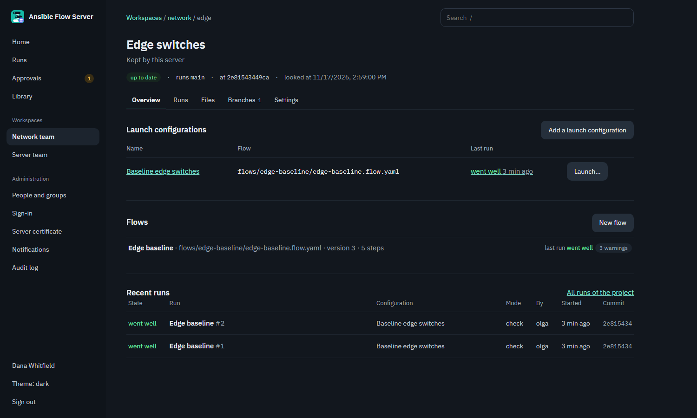

# Workspaces and projects

[The guide](README.md)



A workspace is a team's space. A project in it is a git repository whose flows the server will
run. It has a source somewhere else (the server keeps a mirror of it), or, made without
`gitUrl`, the server hosts it itself. Either way the server knows the commit its branch is at,
and is the address git clients use.

```sh
curl ... -X POST https://flows.example.net:8443/api/v1/workspaces \
  -d '{"key":"network","name":"Network team"}'
curl ... -X POST https://flows.example.net:8443/api/v1/workspaces/network/projects \
  -d '{"key":"edge","name":"Edge switches","gitUrl":"https://git.example.net/network/edge-flows.git"}'
```

```json
{
  "id": "2a968c91-1ac7-4654-94c8-2eb24a28b10b",
  "key": "edge",
  "name": "Edge switches",
  "hosted": false,
  "gitUrl": "https://git.example.net/network/edge-flows.git",
  "gitPath": "/git/network/edge.git",
  "gitRef": "main",
  "commit": "9f2c1e7ab3d45c60e8a1f2b3c4d5e6f708192a3b",
  "sync": { "state": "ok", "at": "2026-11-13T10:15:33.364Z" },
  "pollSeconds": 300,
  "hook": false
}
```

| Address (under `/api/v1`)             | Does                                                                                                                                        | Who                                        |
| ------------------------------------- | ------------------------------------------------------------------------------------------------------------------------------------------- | ------------------------------------------ |
| `/workspaces`, `/workspaces/:id`      | List, add, change, delete (by id or key)                                                                                                    | read: what you see; change: administrators |
| `/workspaces/:id/projects`            | A workspace's projects; add one (its source is looked at at once)                                                                           | as above                                   |
| `POST /workspaces/:id/projects/check` | `{"gitUrl","gitCredential"}`: read a repository's address before adding it; `ok`, its `branches`, or why not (`message`). Nothing is kept   | administrators                             |
| `/projects/:id`                       | A project; change its name, description, source, branch, timer; delete                                                                      | as above                                   |
| `POST /projects/:id/sync`             | Look at the source now                                                                                                                      | `rw` on the workspace                      |
| `GET /samples`                        | The sample projects a hosted project can start from                                                                                         | signed in                                  |
| `POST /projects/:id/start`            | A hosted project's first commit: `{"sample":"hello"}`, or a zip or tar.gz as the body                                                       | `rw` on the workspace                      |
| `GET /projects/:id/branches`          | The branches: names, and each with its newest commit, commits not on the project's branch and the launch configurations that run it         | who sees the project                       |
| `POST /projects/:id/branches`         | `{"name","from"}`: a branch from a branch or a commit                                                                                       | `rw` on the workspace                      |
| `DELETE /projects/:id/branches?name=` | Delete a branch; `&force=true` for one with commits not on the project's branch                                                             | `rw` on the workspace                      |
| `GET /projects/:id/pushes`            | Who pushed what through the server, newest first: name, how (`kind`), commits and the new commit's message                                  | who sees the project                       |
| `GET /projects/:id/flows`             | The flows (`*.flow.yaml`) at the project's commit, each with name, version, steps, errors, warnings and `lastRun`, or why it cannot be read | who sees the project                       |
| `GET /projects/:id/flows/view?path=`  | One flow as the designer shows it (the flow, findings, positions, generated plays)                                                          | `ro` on the workspace or on that flow      |
| `POST /projects/:id/hook`, `DELETE`   | Make a push hook (its token is shown once); remove it                                                                                       | administrators                             |
| `POST /hooks/projects/:id/push`       | Called by the git host with the hook's token                                                                                                | the token                                  |

- **The source** is `https://…`, `ssh://…` or `git@host:path`. An address with a password in it
  is refused. A folder of this machine is allowed only with `AFS_GIT_LOCAL=on`.
- **The branch** (`gitRef`, `main` unless set) is the one whose commits may run.
- **Adding an existing repository** in the pages reads its address first (with the credential
  chosen). One that cannot be read, or has no branch `main`, is said at the address with git's
  reason; **Add anyway** adds it all the same, to fix on its **Settings**.
- **A project's state** (the badge beside its name; hover it for these words): **up to date**
  (the server has the newest commit of the branch), **not read yet** (the server has not fetched
  it yet), **empty** (a project the server hosts, with no commit yet), **cannot be read** (the
  server could not fetch the repository: git's reason follows it; runs use the last commit it
  had; check the address and its sign-in on **Settings**, then **Look at the source now**).
- **A mirror with no commit** (an empty repository, or one never read) has no **Files** tab and
  no **New flow**: its files are added in the repository it mirrors, not here. Its Overview says
  so: push a first commit to the branch with git; the server looks again by itself, or use
  **Look at the source now**.
- **Kept up to date** when added, on request, by the push hook, and every `pollSeconds` (300
  unless set; 0 for never). A source that cannot be reached shows as the project's `sync` state
  with the reason; the commit it had stays.
- **The push hook:** set it up on the project's page (**Push hook**, administrators) or with
  `POST /projects/:id/hook`; its address and token are shown once. GitLab, Gitea and anything that
  can send a header send the token in `X-Gitlab-Token`, `X-AFS-Token` or `Authorization: Bearer`.
  **GitHub** signs each call instead: in the repository's Settings, Webhooks, add one with the
  address as Payload URL, content type `application/json`, the token as Secret, and the push
  event. The server keeps the token sealed with the master key and checks `X-Hub-Signature-256`
  over the call's bytes; GitHub's first call (`ping`) is answered `pong`. A wrong token or
  signature, a project without a hook and no project get the same `401`, and too many from one
  address wait. A hook made before signed hooks has only the token's hash: make a new token for
  GitHub.

  ```text
  Payload URL   https://flows.example.net:8443/api/v1/hooks/projects/2a968c91-1ac7-4654-94c8-2eb24a28b10b/push
  Content type  application/json
  Secret        <the hook's token>
  Events        Just the push event
  ```
- **Name, description and branch:** administrators change them on the project's **Settings**
  tab. A new branch is what the flows, launch configurations and schedules that name no other
  branch run from then on.
- **Deleting:** administrators delete a project at the bottom of its **Settings** tab, and a workspace at the bottom of its **Access** tab, after typing its key. A project goes with its launch configurations, their schedules, its run history and the server's copy of its repository (an external source stays as it is); it is refused while one of its runs goes. A workspace is refused while it still has projects or execution environments. Over the API: `DELETE /api/v1/projects/:id`, `DELETE /api/v1/workspaces/:id`.
- **Who sees some flows only:** someone whose grants in a workspace are on some of its flows
  sees, on the project's page, **Overview** and **Runs** with "You see 2 flows of this project"
  under the title: those flows, their launch configurations and runs. Files, History, Branches
  and Settings are for who has a level on the workspace; the workspace and Home count the
  projects they see. See [Access levels](people-and-sign-in.md#access-levels).
- **A workspace's tab by its name:** `/w/<workspace>/access` (and `environments`,
  `credentials`) opens the tab, at `/w/<workspace>/-/access`, unless a project has that key.
- The server needs the `git` program.

## Starting a hosted project from a sample or an archive

A hosted project can get its first commit from the server instead of a first push: one of the
designer's sample projects, or an archive of your own files. Choose it under **Start with** when
adding the project, or on the project's page while it has no commit (**Start this project**).

```sh
curl ... -X POST https://flows.example.net:8443/api/v1/workspaces/network/projects \
  -d '{"key":"try","name":"Try it","sample":"hello"}'
curl ... -X POST https://flows.example.net:8443/api/v1/projects/<id>/start \
  -H 'content-type: application/gzip' --data-binary @edge-flows.tar.gz
```

- **Samples:** Hello, Ansible (runs on localhost), Edge baseline (with the playbooks and roles it
  binds) and Firewall firmware upgrade (with an approval). Each flow is at
  `flows/<key>/<key>.flow.yaml`, with an `inventory.ini`. Each comes with a launch configuration
  of its flow, its inputs filled in for the sample's hosts, so **Launch** runs it at once (a check
  run unless you change its mode): **Hello on localhost**, **Edge switches (simulated)** and
  **Firewalls on localhost**.
- **Archives:** zip (`application/zip`) or tar.gz (`application/gzip`). One folder that holds
  everything is taken off. The files are committed as they are, `.gitignore` or not; programs in
  a tar.gz stay programs.
- **Refused, with the reason:** a path that leaves the project (`..`, absolute, a drive), links
  and other special entries, a `.git` folder, more than 5,000 files, more than
  `AFS_ARCHIVE_MAX_MB` (50) unpacked, counted while unpacking.
- **Only while empty:** a project with commits (409) is pushed to instead; a project with a
  source starts from its source.
- The commit is by the person who started the project, and shows in the record of pushes; the
  audit log has `project.start`.

## Git: clone, fetch and push through the server

Every project, hosted or with a source, is at `<server><gitPath>`. Sign in with a
[personal access token](people-and-sign-in.md#access-tokens) as the password; the user name is not looked at.

```sh
git clone https://flows.example.net:8443/git/network/edge.git
# Username: dana        Password: <your access token>
git push origin main
```

The project's **Overview** (while it is empty) and **Settings** show the clone command with a
**Copy** button. While the server uses a self-signed certificate, git does not trust it (on
Windows: `SEC_E_UNTRUSTED_ROOT`). Download the certificate in use, from the page's hint or from
`/api/v1/certificate.pem`, and clone with it; `clone -c` keeps the setting in the clone:

```sh
git clone -c http.sslCAInfo=/home/dana/server-certificate.pem https://flows.example.net:8443/git/network/edge.git
# On Windows, add -c http.sslBackend=openssl after clone.
```

- **Who:** `ro` on the workspace clones and fetches, `rw` on it pushes (see
  [Access levels](people-and-sign-in.md#access-levels)). A read-only token never pushes.
- **A hosted project** starts empty, or from a sample or an archive (see above); otherwise the
  first push makes its branch.
- **A project with a source:** a clone or fetch gets what the source has now. A push is passed
  on to the source and is accepted only if the source accepts it. Until credentials exist, that
  works only where the server's own account may push to the source.
- **The project's branch** (`gitRef`) cannot be deleted and its history cannot be rewritten
  through the server. Other branches are free. Only branches are pushed, not tags.
- **Who pushed** is kept (`GET /projects/:id/pushes`); commits keep their own authors.

## Branches

The project's page lists its branches with their newest commit and how many of its commits are
not on the project's branch. Who may push makes a branch from a branch or a commit and deletes
one; administrators make another branch the project's branch (the one that runs), which is
`PATCH /projects/:id {"gitRef"}`.

- **For a project with a source** the branch is made or deleted at the source first, with the
  project's credential, as a push through the server is; the mirror follows only what the source
  took.
- **Never deleted:** the project's branch, and a branch a launch configuration runs (the answer
  names them; change those first).
- **Asked again:** a branch with commits that are not on the project's branch (`409 unmerged`
  with the count; `force=true` deletes it). For a hosted project those commits are then gone.
- Each change is in the record of pushes and the audit log (`project.branch-create`,
  `project.branch-delete`, with the branch's name).
- Deleting a hosted project puts its repository aside in `data/repos/deleted`: it was the
  only copy.

```json
[
  {
    "id": "5d0c2f0e-0f52-4a55-a2f4-0d2f5c0e7a11",
    "login": "dana",
    "ref": "main",
    "from": "9f2c1e7ab3d45c60e8a1f2b3c4d5e6f708192a3b",
    "to": "41d7a0c93be2f5681a0c4e7d9b3f2a6c8e1d0b57",
    "at": "2026-11-13T12:09:23.386Z"
  }
]
```

For a private repository see [Credentials](credentials.md).
